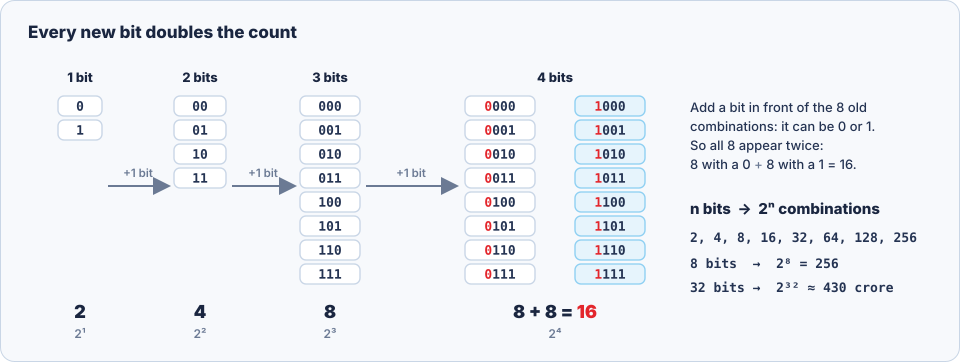
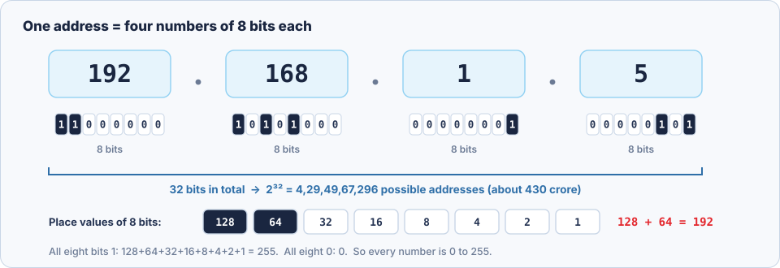
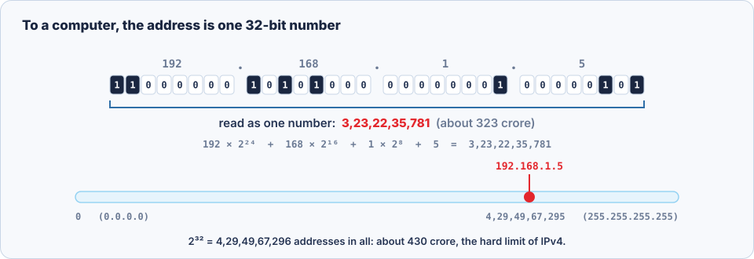
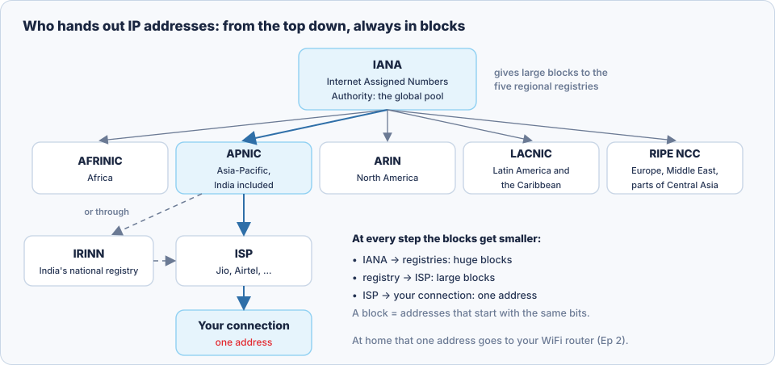
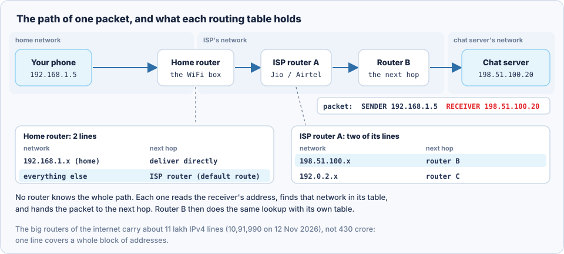
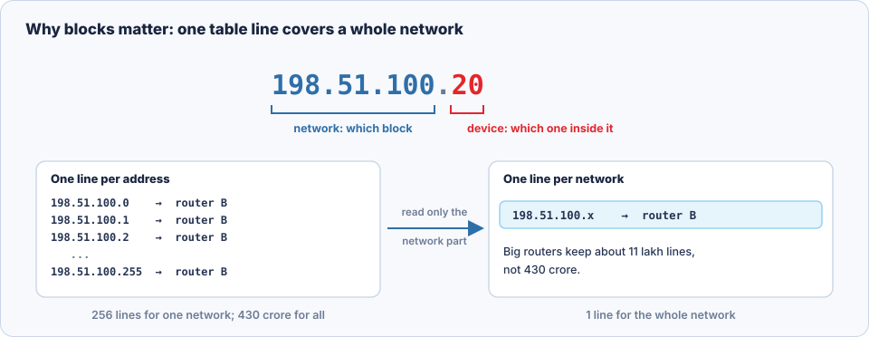
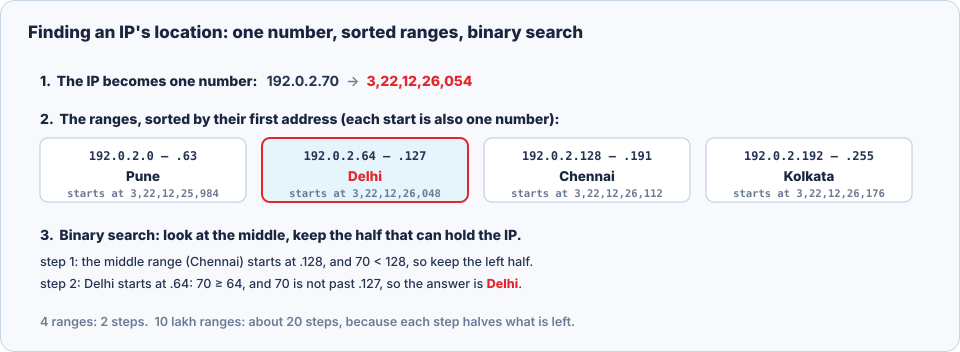

# Episode 1: IP Address

**System Design for Beginners (Hindi) · Code Man**

These are the notes for Episode 1. The video explains everything step by step in Hindi; these notes follow the same path in simple English, go a little deeper, and are made to be revised quickly before an interview. Boxes marked **Beyond the video** are extra material the video had no time for.

- Video: *link added when the episode is published*
- PDF of these notes: [ep01-ip-address.pdf](ep01-ip-address.pdf)
- Next episode: [Ep 2: Subnet Mask, Private IP & NAT](../ep02-subnet-mask-nat/README.md)

The example addresses come from the home range `192.168.x.x` and from the ranges kept for documentation (`192.0.2.x`, `198.51.100.x`, `203.0.113.x`), never from a real company.

## In one minute

- An **IP address** is the address of a device on a network. Data travels in small pieces called **packets**, and every packet carries two addresses: the sender's and the receiver's.
- An IPv4 address such as `192.168.1.5` is four numbers of **8 bits** each. 8 bits have 2⁸ = 256 combinations, so each number is 0 to 255.
- To a computer the address is **one 32-bit number**. 32 bits give 2³² = 4,29,49,67,296 addresses, about **430 crore**: the hard limit of IPv4.
- Addresses are handed out **from the top down, always in blocks**: IANA → five regional registries → ISPs → your connection.
- A **router** connects two networks and forwards packets. Its **routing table** says, for each network, which router gets the packet next: the **next hop**. No router knows the whole path.
- Because addresses come in blocks, an address is read in **two parts**, the network and the device. Routers keep one line per network, so the biggest routers hold about **11 lakh** lines, not 430 crore.
- Left for Ep 2: where does the network part end? The **subnet mask** answers that.

## 1. What an IP address is

**IP** stands for **Internet Protocol**: the rules by which devices on the internet send data to each other. An **IP address** is a device's address under those rules.

`192.168.1.5` is one: four numbers, three dots.

Data does not travel as one long stream. It is cut into small parts called **packets**, and every packet carries two addresses, like a parcel:

| Field | In our example | Whose address |
|---|---|---|
| Sender | `192.168.1.5` | your phone |
| Receiver | `198.51.100.20` | the chat app's server |

Three questions run through this episode and the next:

1. Why four numbers, and not three or five?
2. Why does every number stop at 255?
3. Why is this exact address written on lakhs of other phones right now? (Ep 2)

> **Beyond the video.** An address belongs to a network connection (an *interface*), not to the whole device. A laptop on WiFi and on a cable at the same time has two addresses; the standards call such a device *multihomed*. Most phones also have IPv6 addresses next to the IPv4 one (Ep 2).

## 2. Bits: why every number is 0 to 255

A **bit** (binary digit) is one place that holds one of two values: 0 or 1.

- 1 bit can tell apart 2 things: `0` and `1`.
- 2 bits give 4 combinations: `00`, `01`, `10`, `11`.
- 3 bits give 8.

**Why the count doubles.** Write down the 8 combinations of 3 bits, then add a fourth bit in front. It can be 0 in front of all 8, or 1 in front of all 8: 8 + 8 = 16. Every new bit does the same, so **n bits give 2ⁿ combinations**.



| Bits | Combinations |
|---|---|
| 1 | 2 |
| 2 | 4 |
| 3 | 8 |
| 4 | 16 |
| 8 | 2⁸ = 256 |
| 32 | 2³² = 4,29,49,67,296 |

**Eight bits: 0 to 255.** Of the 256 combinations of 8 bits, the smallest is all eight bits 0, the number 0, and the largest is all eight bits 1, which is 255. So 256 combinations cover exactly 0 to 255.

**From bits to a number.** Every bit has a **position**, counted from the right and starting at 0. Each position has a **value**: 2 to the power of the position.

| Position | 7 | 6 | 5 | 4 | 3 | 2 | 1 | 0 |
|---|---|---|---|---|---|---|---|---|
| Value | 128 | 64 | 32 | 16 | 8 | 4 | 2 | 1 |

Multiply each value by its bit (0 or 1) and add everything up.

- `11111111` = 128 + 64 + 32 + 16 + 8 + 4 + 2 + 1 = **255**
- `11000000` = 128 + 64 = **192**
- `10101000` = 128 + 32 + 8 = **168**
- `00000001` = **1**
- `00000101` = 4 + 1 = **5**

So `192.168.1.5` in bits is `11000000.10101000.00000001.00000101`.



**Why not 256?** 256 in bits is `1 0000 0000`: nine bits. Each number of an IPv4 address has only eight, so 256 cannot be written. That is why `192.168.1.256` is not a valid address.

**The other way: a number to bits.** Go from the biggest place value to the smallest. If the value fits into what is left, write 1 and subtract it; if not, write 0. For 168:

| Place value | 128 | 64 | 32 | 16 | 8 | 4 | 2 | 1 |
|---|---|---|---|---|---|---|---|---|
| Left before | 168 | 40 | 40 | 8 | 8 | 0 | 0 | 0 |
| Fits? | yes | no | yes | no | yes | no | no | no |
| Bit | 1 | 0 | 1 | 0 | 1 | 0 | 0 | 0 |

168 = `10101000`.

> **Beyond the video.** A group of 8 bits is a **byte**. Networking standards call it an **octet**, so the four numbers of an IPv4 address are its four octets. "The last octet" is a phrase you will hear in interviews.

## 3. One 32-bit number

Put the four groups of 8 bits one after the other and you get one line of **32 bits**. To a computer, that line *is* the address; there are no dots. The dots exist only for people, because 32 bits are easier to read as four groups of eight. That also answers "why four numbers": 32 ÷ 8 = 4.

Read the 32 bits as one number and `192.168.1.5` becomes **3,23,22,35,781**, about 323 crore:

```
192 × 1,67,77,216  =  3,22,12,25,472      (1,67,77,216 = 2²⁴)
168 ×     65,536   =      1,10,10,048      (65,536 = 2¹⁶)
  1 ×        256   =              256      (256 = 2⁸)
  5 ×          1   =                5
                      ---------------
                       3,23,22,35,781
```



How many addresses can 32 bits make? 2³² = **4,29,49,67,296**: about **430 crore** (4.3 billion). This system is **IPv4**, Internet Protocol version 4, a design from 1981, and 430 crore is its hard limit: not one address more can exist. Keep this number in mind; Ep 2 is the story of running out of it.

> **Beyond the video.** Programs store and compare IP addresses as these numbers: "is this address inside that range?" becomes two integer comparisons. Interview question 4 below is built on it. You can even type the number instead of the dots: on a Mac or Linux terminal, `ping 2130706433` pings `127.0.0.1`, the address that always means "this computer".

## 4. Who hands out addresses

A public address must be unique on the whole internet, so somebody has to hand the addresses out. It happens from the top down, and **always in blocks**. A block is a run of addresses that all start with the same bits.

1. **IANA** (Internet Assigned Numbers Authority) holds the global pool. It does not give out single addresses: it gives big blocks to the five **regional registries**.
2. The five **Regional Internet Registries** each serve one part of the world: AFRINIC (Africa), **APNIC** (Asia-Pacific, India included), ARIN (North America), LACNIC (Latin America and the Caribbean) and RIPE NCC (Europe, the Middle East and parts of Central Asia).
3. They give blocks to internet companies such as Jio or Airtel. Such a company is an **ISP**: Internet Service Provider.
4. The ISP gives one address from its block to your connection.



> **Beyond the video.** APNIC is the Asia Pacific Network Information Centre. India also has its own national registry, **IRINN** (Indian Registry for Internet Names and Numbers), run by NIXI, the National Internet Exchange of India. An Indian network can get its block from APNIC directly or through IRINN.

> **Beyond the video.** At home, the one address from your ISP goes to your WiFi router, not to your phone. The router then lends every device in the home an address of its own, such as `192.168.1.5`, from a range that works only inside the home. How that works, and why it is allowed, is Ep 2: private addresses, DHCP and NAT.

Why blocks matter is the next question: how does a packet find its way to the right address?

## 5. Routers: how a packet travels

**The example used in both episodes.** You are at home, your phone is on WiFi, and you send a message to a friend.

- Your phone's address is `192.168.1.5`.
- The message first goes to the chat app's **server**: the computer where the app runs and its data is kept. Its address is `198.51.100.20`.
- So the packet carries the sender `192.168.1.5` and the receiver `198.51.100.20`.

The packet goes first to the WiFi box at home. That box is a **router**.

**A router is a device that connects two networks and forwards packets from one network to the other.** Your home router connects your home network to your ISP's network.



- **On mobile data** there is no WiFi box. The packet goes through the tower straight into Jio's or Airtel's network, and their routers take it from there.
- **Your phone is not a router.**
- Inside the ISP's network there are more routers, and the ISPs are connected to each other, and to other countries, by big routers.

> **Beyond the video.** Turn on your phone's hotspot and it does become a router: it joins the hotspot network (your laptop, a friend's phone) to the mobile network and forwards their packets.

> **Beyond the video.** Every IPv4 packet also carries a hop counter called **TTL** (time to live). Each router lowers it by 1, and the router that brings it to 0 drops the packet and sends an error message back. So a packet caught in a loop dies instead of circling forever. The `traceroute` tool uses this to list every router on the way (see *Try it yourself*).

## 6. Two parts: network and device, and the routing table

How does each router know which way the server is?

If addresses were handed out in no order, every router would need a separate direction for each of the 430 crore addresses, and would have to search that list for every single packet. That is not possible.

**Blocks solve it.** The company that runs the chat server got a whole block: all the addresses whose first three numbers are `198.51.100`, from `198.51.100.0` to `198.51.100.255`. Every address in that block starts with the same bits.

So an address is read in **two parts**:

- the first bits say the **network**: which block;
- the rest say the **device**: which one inside that network.

A router does not need to remember devices. It only needs to know which way to send the packets of each network.



**The routing table.** Every router keeps one, and every line has two things:

- a network;
- the **next hop**: the next router that should get the packets for that network.

In our example, ISP router A has a line like `198.51.100.x → router B`. A packet arrives; the router reads the receiver's address, finds its network in the table, and hands the packet to router B. Router B has its own table and does the same thing again.

**No router knows the whole path. Each one only knows the next step.**

Your home router's table is tiny, just two lines:

| Network | Next hop |
|---|---|
| `192.168.1.x` (the home's own devices) | deliver directly |
| everything else | the ISP's router: the **default route** |

The big routers of the internet have the same kind of table, only much bigger: about **11 lakh lines** (10,91,990 IPv4 lines on 12 November 2026). Not 430 crore, because one line covers a whole block.

> **Beyond the video: longest prefix match.** One address can match more than one line: `198.51.100.20` matches `198.51.100.x`, and it also matches "everything else". The router always picks the most specific line, the one that fixes the most leading bits. This rule is **longest prefix match**, and it is why the default route is used only when nothing else fits. The biggest routers of the internet carry the full table and usually have no default route at all.

Ep 2 writes the network `198.51.100.x` the way engineers do: `198.51.100.0/24`.

## 7. The question left for Ep 2

Where does the network part end: after 8 bits, 16 or 24? From the address alone you cannot tell. A second number that travels with every address answers it: the **subnet mask**. That is where [Ep 2](../ep02-subnet-mask-nat/README.md) starts, together with the third question: why the same address is written on lakhs of phones.

## 8. Interview questions

Each question says where it comes from:

- **Reported**: a candidate wrote publicly that they were asked it. It does not mean the company still asks it.
- **Our question**: written by us to test the idea.

The first five are the video's interview round. Try each one before you read the answer.

### From the video

**1. Is `192.168.1.256` a valid IPv4 address?**

*Reported by 3 candidates · Microsoft · GeeksforGeeks.* The reported task was bigger: write code that checks whether an IP address is valid.

No. Each number has 8 bits, so it can only be 0 to 255; 256 needs a ninth bit.

The full coding task, in Python:

```python
def is_valid_ipv4(s: str) -> bool:
    parts = s.split(".")
    if len(parts) != 4:                        # exactly four numbers
        return False
    for p in parts:
        if not (p.isascii() and p.isdigit()):  # digits only: no "", "+1", " 1" or "a"
            return False
        if len(p) > 1 and p[0] == "0":         # no leading zero, like "01"
            return False
        if int(p) > 255:                       # 8 bits: 0 to 255
            return False
    return True
```

Test it: `192.168.1.5` is valid; `192.168.1.256`, `192.168.01.5`, `192.168.1` and `1..2.3` are not. The same task is LeetCode 468, *Validate IP Address*, which adds IPv6.

**2. Where do IP addresses come from?**

*Reported · Cisco · internship, off-campus · GeeksforGeeks, updated 2 Dec 2020.* The write-up words it as "How the IP addresses are generated".

From the top down, and always in blocks: IANA gives blocks to the regional registries, they give blocks to ISPs, and an ISP gives one address to your connection. A fuller answer adds the last step: inside your home, the router lends each device an address with **DHCP** (Ep 2).

**3. Which number is `1111 0000`?**

*Our question · calculation.*

**240** = 128 + 64 + 32 + 16. A quicker way: all eight ones make 255, and the four ones that are missing (`0000 1111`) make 15, so 255 − 15 = 240.

**4. You have a list of IP ranges, and each range has a location. How do you find the location of any IP as fast as possible?**

*Reported by 3 candidates · Google · LeetCode Discuss.*

Turn every IP into its 32-bit number, so each range becomes two numbers: start and end. Sort the ranges by start. For a query, binary-search for the last range that starts at or before the IP, then check that the IP is not past that range's end.



```python
import bisect

def ip_to_int(ip: str) -> int:
    a, b, c, d = (int(x) for x in ip.split("."))
    return a * 256**3 + b * 256**2 + c * 256 + d

ranges = [("192.0.2.0",   "192.0.2.63",  "Pune"),
          ("192.0.2.64",  "192.0.2.127", "Delhi"),
          ("192.0.2.128", "192.0.2.191", "Chennai"),
          ("192.0.2.192", "192.0.2.255", "Kolkata")]

table = sorted((ip_to_int(s), ip_to_int(e), place) for s, e, place in ranges)
starts = [row[0] for row in table]

def locate(ip: str):
    n = ip_to_int(ip)
    i = bisect.bisect_right(starts, n) - 1   # the last range that starts at or before n
    if i >= 0 and n <= table[i][1]:
        return table[i][2]
    return None                               # the IP is in no range

print(locate("192.0.2.70"))   # Delhi
```

- Sorting costs O(n log n) once; every lookup is O(log n). For 10 lakh ranges that is about 20 steps per lookup.
- The ranges must not overlap. Ask the interviewer, or merge them first.
- A common slip: converting with 255 instead of 256. Each number has 256 possible values (0 to 255), so the base is 256.

**5. You are designing a big internet router. Would its table keep one line for every address?**

*Our question · system design.*

No. Addresses are handed out in blocks, so one line covers a whole network. That is why the biggest routers hold about 11 lakh lines instead of 430 crore.

### More practice

**6. Can a system have more than one IP address?**

*Reported · Cisco · Technical Consulting Engineer, campus · GeeksforGeeks, updated 11 Aug 2021.*

Yes. An address belongs to each network connection, not to the computer: a laptop on WiFi and on a cable has two. Most devices today also have an IPv4 and an IPv6 address at the same time.

**7. What does a router do?**

*Reported · Cisco · Technical Consulting Engineer, campus · GeeksforGeeks, updated 11 Aug 2021* (the same write-up).

It connects two or more networks and forwards packets between them. For every packet it reads the receiver's address, finds the most specific matching line in its routing table, and hands the packet to that line's next hop. A home router does more jobs in the same box: it lends addresses (DHCP) and shares one public address (NAT), both in Ep 2.

**8. A packet's address matches no line in the routing table. What happens to it?**

*Reported by 2 candidates · Square and Forward Networks · LeetCode Discuss.* Both were asked to code a routing table.

If the table has a default route, the packet goes to the default route's next hop. If it has none, the router drops the packet, and usually sends an error message back to the sender.

**9. From a string of digits, list every valid IP address you can make.**

*Reported by 2 candidates · Amazon · GeeksforGeeks.* It is LeetCode 93, *Restore IP Addresses*.

Small version first: from the digits `12345`, in this order, how many valid addresses? **Four**: `1.2.3.45`, `1.2.34.5`, `1.23.4.5` and `12.3.4.5`. One part must take two digits, and it can be any of the four parts.

```python
def restore(s: str) -> list[str]:
    out = []

    def ok(p):                  # one part: no leading zero, at most 255
        return len(p) == 1 or (p[0] != "0" and int(p) <= 255)

    def go(i, parts):
        if len(parts) == 4:
            if i == len(s):
                out.append(".".join(parts))
            return
        for size in (1, 2, 3):
            p = s[i:i + size]
            if len(p) == size and ok(p):
                go(i + size, parts + [p])

    go(0, [])
    return out

print(restore("12345"))   # ['1.2.3.45', '1.2.34.5', '1.23.4.5', '12.3.4.5']
```

**10. What does `traceroute` show, and how does it work?**

*Reported · Cisco · internship, off-campus · GeeksforGeeks, updated 2 Dec 2020* (the same write-up as question 2).

It lists the routers on the way to a destination. It sends packets with a TTL of 1, then 2, then 3, and so on. The router that brings a packet's TTL to 0 drops it and sends an error message back, and that message tells traceroute the router's address.

## 9. Try it yourself

1. **Your phone's address.** Open the WiFi settings, tap the network you are on, and find the IP address. At home it most likely starts with `192.168`. Ep 2 explains why.
2. **Bits by hand, then check.** Write each number of that address in bits with the place values. Then check: `python3 -c "print(format(168, '08b'))"` prints `10101000`.
3. **The address as one number.** `python3 -c "import ipaddress; print(int(ipaddress.ip_address('192.168.1.5')))"` prints `3232235781`. On a Mac or Linux terminal, `ping 2130706433` pings `127.0.0.1`: the dots really are only for people.
4. **See the routers on the way.** Run `traceroute google.com` on a Mac or Linux, or `tracert google.com` on Windows. Each line is one router. A line of `* * *` is a router that did not answer, which is normal.

## 10. One-page revision

- IP = Internet Protocol. A packet carries a sender address and a receiver address.
- Bit = 0 or 1. n bits give 2ⁿ combinations; every new bit doubles the count.
- 8 bits = 256 combinations = 0 to 255. Place values: 128 64 32 16 8 4 2 1. 256 needs a ninth bit.
- IPv4 = 32 bits = 4 numbers × 8 bits. To a computer, one number: 192.168.1.5 = 3,23,22,35,781.
- 2³² = 4,29,49,67,296 ≈ 430 crore: IPv4's hard limit (a 1981 design).
- IANA → 5 regional registries (APNIC for India; IRINN in India) → ISP → your connection. Always in blocks.
- Router: joins two networks and forwards packets. A phone is not one, unless its hotspot is on.
- Routing table line = network + next hop. Default route = everything else. Longest prefix match picks the most specific line.
- Address = network part + device part. The biggest routers: about 11 lakh lines, not 430 crore.
- Next: the subnet mask says where the network part ends.

## Sources

- IPv4 (1981), octets and TTL: [RFC 791](https://www.rfc-editor.org/rfc/rfc791.html) · A host with more than one address (multihomed): [RFC 1122](https://www.rfc-editor.org/rfc/rfc1122.html) · How routers forward, and the most specific match: [RFC 1812](https://www.rfc-editor.org/rfc/rfc1812.html) · Blocks and aggregation: [RFC 4632](https://www.rfc-editor.org/rfc/rfc4632.html)
- Address registries: [IANA number resources](https://www.iana.org/numbers) · [APNIC](https://www.apnic.net/) · [IRINN](https://www.irinn.in/)
- Routing table size: [CIDR Report](https://www.cidr-report.org/as2.0/) (read 12 November 2026)
- traceroute on Windows: [Microsoft tracert reference](https://learn.microsoft.com/en-us/windows-server/administration/windows-commands/tracert)
- Interview write-ups: Microsoft [1](https://www.geeksforgeeks.org/interview-experiences/microsoft-interview-set-7-3/) · [2](https://www.geeksforgeeks.org/interview-experiences/microsoft-interview-experience-set-164-campus-internship/) · [3](https://www.geeksforgeeks.org/interview-experiences/microsoft-idc-internship-interview-experience/) · [Cisco internship 2020](https://www.geeksforgeeks.org/interview-experiences/cisco-interview-experience-for-internship-off-campus-2020/) · Google [1](https://leetcode.com/discuss/post/2058209/google-phone-screening-mountain-view-ca-pirf5/) · [2](https://leetcode.com/discuss/interview-question/5442458/) · [3](https://leetcode.com/discuss/interview-experience/6084864/Google-L4-interview-expereince) · [Cisco campus](https://www.geeksforgeeks.org/interview-experiences/cisco-interview-experience-on-campus-5/) · [Square](https://leetcode.com/discuss/interview-experience/3973772/) · [Forward Networks](https://leetcode.com/discuss/post/7697450/begged-interviewer-to-let-me-drop-off-th-s22n/) · Amazon [1](https://www.geeksforgeeks.org/interview-experiences/amazon-interview-experience-set-268-experienced/) · [2](https://www.geeksforgeeks.org/interview-experiences/amazon-interview-experience-for-sde-ii/)
