# Episode 2: Subnet Mask, Private IP & NAT

**System Design for Beginners (Hindi) · Code Man**

These are the notes for Episode 2. The video explains everything step by step in Hindi; these notes follow the same path in simple English, go a little deeper, and are made to be revised quickly before an interview. Boxes marked **Beyond the video** are extra material the video had no time for.

- Video: *link added when the episode is published*
- PDF of these notes: [ep02-subnet-mask-nat.pdf](ep02-subnet-mask-nat.pdf)
- Previous episode: [Ep 1: IP Address](../ep01-ip-address/README.md) · Next: Ep 3, DNS (Domain Name System)

The example addresses come from the private ranges (`192.168.x.x`, `10.x.x.x`) and from the ranges kept for documentation (`192.0.2.x`, `198.51.100.x`, `203.0.113.x`, `2001:db8::`), never from a real company.

## In one minute

- The address alone does not say where the network part ends. The **subnet mask** does: a 1 for every network bit and a 0 for every device bit. On home WiFi it is usually `255.255.255.0`, written **/24**.
- Before sending, a device runs an **AND** of the mask with its own address and with the receiver's. Same result: same network, send directly. Different: send the packet to the **gateway**, the home router.
- A /24 has 256 addresses but only **254 for devices**: the first is the **network address** and the last is the **broadcast address**. With n device bits: 2ⁿ − 2. Cutting a network into smaller ones is **subnetting**: every extra mask bit makes twice as many pieces, each half the size. To find the network and broadcast address of any address, write it in bits and set the device bits to all 0 or all 1.
- **DHCP** lends a device its address, the mask and the gateway when it joins a network.
- IPv4 has only about 430 crore addresses, and IANA's free pool ran out in 2011. Three **private** blocks are reused inside every home and office, which is why `192.168.1.5` is on lakhs of phones.
- **NAT**: the home router swaps the private sender address for its one **public** address, and a table of **ports** sends every reply to the right device. Conversations can only start from inside, so a server needs a fixed public address: a **static IP**.
- One public IP can be a whole home, office or college. Never treat an IP address as one person.
- **IPv6** removes the limit with 128 bits: 2¹²⁸ ≈ 3.4 × 10³⁸ addresses. Today IPv4 and IPv6 run side by side.

## 0. Where Ep 1 left off

- An IPv4 address is 32 bits, written as four numbers of 8 bits each.
- Addresses are handed out in blocks, so every address is read in two parts: the **network** (which block) and the **device** (which one inside it).
- Routers read only the network part. Each keeps a **routing table**: network → next hop.
- The example: your phone `192.168.1.5`, at home on WiFi, sends a message. The packet goes through the home router and the ISP's routers to the chat app's server, `198.51.100.20`.

The open question: where does the network part end? After 8 bits, 16 or 24? From the address alone you cannot tell. ([Ep 1's notes](../ep01-ip-address/README.md))

## 1. The subnet mask

So a second number always travels with the address: the **subnet mask**.

- It is also 32 bits long.
- Its rule: **1 for every network bit, 0 for every device bit**. The ones always come first, then the zeros.
- On home WiFi it is usually 24 ones and then 8 zeros.
- Written as four numbers, eight 1s are 255 and eight 0s are 0, so the mask is `255.255.255.0`. Your phone's WiFi settings show exactly this.
- The short form is **/24** ("slash 24"): just the count of ones. This way of writing is **CIDR notation** (Classless Inter-Domain Routing). `192.168.1.5/24` means the address and its mask together.

**How a device uses the mask: the AND.** It compares every bit of the address with the bit in the same position of the mask. Where the mask has 1, the address bit stays as it is; where the mask has 0, the bit becomes 0. This operation is called **AND**.

| Address bit | Mask bit | Result |
|---|---|---|
| 0 | 1 | 0 (kept) |
| 1 | 1 | 1 (kept) |
| 0 | 0 | 0 |
| 1 | 0 | 0 |

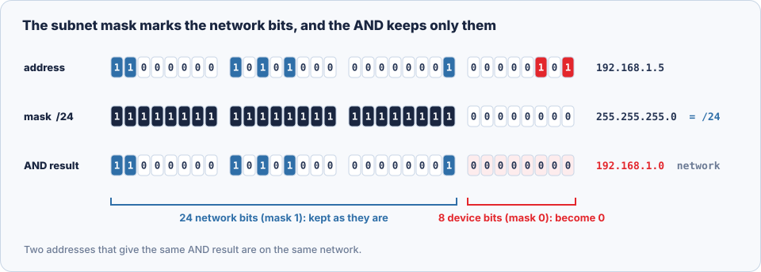

`192.168.1.5` AND `255.255.255.0` = `192.168.1.0`: the first three numbers stay, the last becomes 0. What is left is the address of the network itself.

## 2. Same network or not? The gateway

Before sending a packet, the phone applies its mask to its own address and to the receiver's address, and compares the two results.

| Receiver | AND with 255.255.255.0 | Same as 192.168.1.0? | The packet goes to |
|---|---|---|---|
| `198.51.100.20` (the chat server) | `198.51.100.0` | no | the **gateway**: the home router, `192.168.1.1` |
| `192.168.1.12` (the TV at home) | `192.168.1.0` | yes | the TV, directly |

For the server the results differ, so the server is not on the home network. The phone hands the packet to the home router, which in this role is called the **gateway**: the door out of the home network. The phone learns the gateway's address together with its own (section 5).

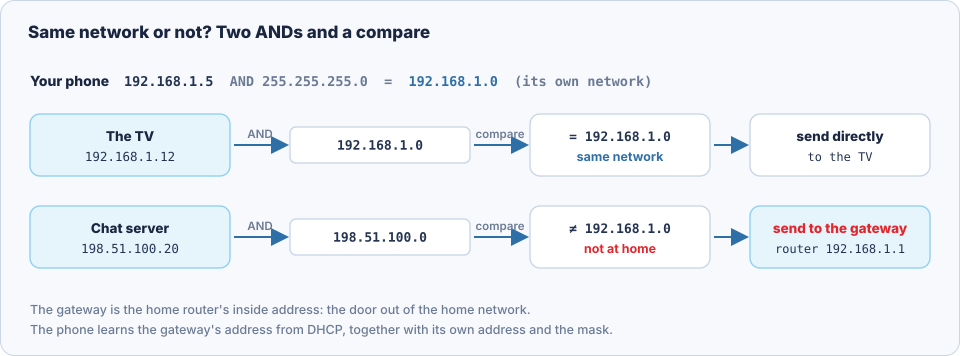

> **Beyond the video: the TV.** Send something to the TV instead and both results are `192.168.1.0`. Same network, so the packet goes straight to the TV without being routed. (On WiFi the radio signal still passes through the WiFi box, but the box only passes it along inside the home network; it does not route it.)

> **Beyond the video: Ep 1's routing tables, written properly.** With the slash, the tables from Ep 1 read:
>
> | Router | Network | Next hop |
> |---|---|---|
> | home router | `192.168.1.0/24` | deliver directly |
> | home router | `0.0.0.0/0` | the ISP's router (default route) |
> | ISP router A | `198.51.100.0/24` | router B |
>
> The default route is `0.0.0.0/0`: a mask with no ones at all. ANDed with it, every address becomes `0.0.0.0`, so this line matches everything, and longest prefix match uses it only when no other line fits. The whole decision of where a packet goes next is made with ANDs: AND both addresses with the mask, then compare.

## 3. How many devices fit: network and broadcast addresses

The video's first question: *with /24, eight bits are left for devices. How many devices can get an address? A: 256 · B: 255 · C: 254.*

The answer is **C: 254**.

- Eight bits make 256 combinations, `.0` to `.255`.
- Two of them are never given to a device:
    - all device bits 0 (`192.168.1.0`): the **network address**, the network's own name. It is the same result the AND gave.
    - all device bits 1 (`192.168.1.255`): the **broadcast address**. A packet sent to it goes to every device on the network.
- 256 − 2 = **254**.

The same calculation works for every size: **with n device bits, a network has 2ⁿ addresses, and 2ⁿ − 2 of them are for devices.**

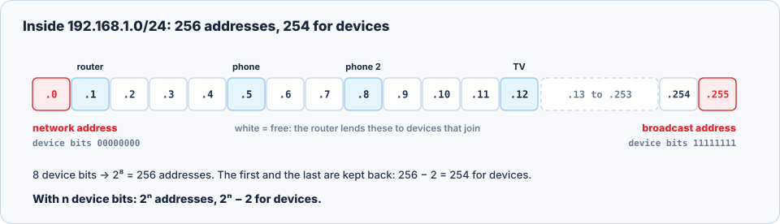

| Prefix | Mask | Device bits | Addresses | For devices |
|---|---|---|---|---|
| /8 | 255.0.0.0 | 24 | 1,67,77,216 | 1,67,77,214 |
| /16 | 255.255.0.0 | 16 | 65,536 | 65,534 |
| /24 | 255.255.255.0 | 8 | 256 | 254 |
| /25 | 255.255.255.128 | 7 | 128 | 126 |
| /26 | 255.255.255.192 | 6 | 64 | 62 |
| /27 | 255.255.255.224 | 5 | 32 | 30 |
| /28 | 255.255.255.240 | 4 | 16 | 14 |
| /30 | 255.255.255.252 | 2 | 4 | 2 |

Two special sizes: a **/31** is used for a link between two routers, where both addresses are used (such a link needs no network or broadcast address), and a **/32** is one single address.

## 4. Subnetting: one block, two networks

**The need.** Say my company, CodeMan, runs its app on AWS (Amazon Web Services, Amazon's cloud). There I made my own network and took one address block for it: `10.0.0.0/24`. The first three numbers are fixed and the last one is mine, 0 to 255: 256 addresses. From here on, only the last number matters.

I run two kinds of servers: **web servers**, which your phone talks to, and **database servers**, which hold every user's data. If they all sit in one network, every server can talk straight to every other one, and a hacked web server has an open road to the database. So I want them in two separate networks: then every packet from one to the other passes a **router**, and on the router I can put rules.

**The cut.** I have only one block, so I cut it in the middle: 0 to 127 for the web servers, 128 to 255 for the databases. Every device has to know about this cut, and the **mask** is what tells it.

- A mask's 1s always run without a gap from the left. /24 had 24 of them, so the next bit is the first bit of the last number: the **128 bit**.
- I give that bit to the network too. Now the network has 25 bits, **/25**, and in the mask's last number only the 128 bit is 1: the mask is `255.255.255.128`.

**Why one bit makes exactly two halves.**

- If that bit is 0 in an address, the other seven bits can only make 0 to 127.
- If it is 1, the number starts at 128 and goes up to 255.
- The rule the phone used in section 2: addresses whose network bits are the same are in the same network. So 0 to 127 is one network, and 128 to 255 is another.
- To check, use the same AND: `.5` AND `.128` gives 0, and `.200` AND `.128` gives 128. Different results, so different networks.

Every smaller network made inside a network like this is a **subnet**, and the whole job is **subnetting**.

**Each half is a full network.** The old rule holds in every subnet: its first address is its network address and its last address is its broadcast address.

| Subnet | Written as | Network address | Devices | Broadcast address |
|---|---|---|---|---|
| Web servers | `10.0.0.0/25` | `10.0.0.0` | `.1` to `.126` | `10.0.0.127` |
| Databases | `10.0.0.128/25` | `10.0.0.128` | `.129` to `.254` | `10.0.0.255` |

Now every packet from a web server to a database goes through the router, and the router's rule says: only the web servers may reach the database, nobody from the internet.

**More bits, more pieces.** Need more networks later? Give the network one more bit.

| Prefix | Bits of the last number in the network | Mask | Subnets in one /24 | Addresses in each | They start at |
|---|---|---|---|---|---|
| /25 | 128 | 255.255.255.128 | 2 | 128 | .0, .128 |
| /26 | 128 + 64 | 255.255.255.192 | 4 | 64 | .0, .64, .128, .192 |
| /27 | 128 + 64 + 32 | 255.255.255.224 | 8 | 32 | .0, .32, .64 … .224 |

Every new bit doubles the number of subnets and halves their size. That is why a cut cannot go just anywhere: the pieces are always 128, 64, 32, 16 … addresses.

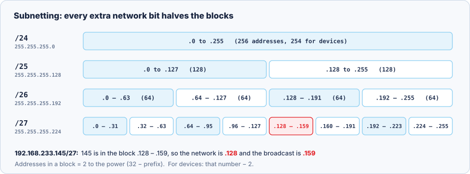

**The same address with two masks.** Take `10.0.0.200`. With /24 it is in a network of 256 addresses that starts at `.0`. With /25 it is in a network of 128 addresses that starts at `.128`. So an address alone is incomplete: the address and the mask together tell which network a device is in. And the mask is chosen by whoever owns the network; here, me.

**The bit method: the network and broadcast address of any address.** The easiest way is to write the address in bits.

Example: my network is cut into /26 subnets, and one server's last number is 70.

1. Write the last number in bits: 70 = 64 + 4 + 2 = `0100 0110`.
2. Draw the mask's line. Of /26's 26 bits, 24 are used up by the first three numbers, so only the first **2** bits of the last number, `01`, are network bits; the other 6 are device bits: `01 | 000110`.
3. Set every device bit to 0: `01 000000` = 64. The **network address** is `10.0.0.64`.
4. Set every device bit to 1: `01 111111` = 64 + 63 = 127. The **broadcast address** is `10.0.0.127`.

Never touch the network bits: they come from your address. The mask only tells you where to draw the line.

**Worked example: `192.168.233.145/27`** (interview question 3).

1. /27 means the first 27 bits are network bits: 24 in the first three numbers and the first **3** bits of the last number. The other 5 bits are device bits.
2. 145 = 128 + 16 + 1, so in bits it is `100 10001`. The first three, `100`, are network bits.
3. Device bits to 0: `100 00000` = 128. Network address `192.168.233.128`.
4. Device bits to 1: `100 11111` = 159. Broadcast address `192.168.233.159`.
5. The devices are `.129` to `.158`: 2⁵ − 2 = 30 of them.

**A shortcut for the block size:** 256 minus the last mask number that is not 255. For /27 the mask is `255.255.255.224`, and 256 − 224 = 32, so the blocks start at 0, 32, 64, 96, 128, 160 … and 145 is in the block `.128` to `.159`. Both ways give the same answer; the bit method shows why.

**Bigger blocks work the same way.**

- On AWS, companies usually take a **/16** block: the first two numbers fixed, 65,536 addresses.
- They cut it into **/24** subnets: all addresses that start with `10.0.1` for web servers, `10.0.2` for databases. Here the cut sits on the whole third number.
- **/17** and **/18** are nothing new: the cut falls inside the third number's bits. A /17 splits a /16 into two halves, a /18 into four.
- Offices do the same: the guests' WiFi on one subnet, the employees on another, and the CCTV (closed-circuit television) cameras on a third.

> **Beyond the video: subnets in the cloud.** When a company builds its network in the cloud (on servers it rents), its very first decision is this one: how many bits for the network, and how many for devices.
>
> - On AWS, a VPC (Virtual Private Cloud: your own private network in the cloud) gets a block between /16 and /28. A block cannot be resized later; you can only add more blocks.
> - AWS keeps back five addresses in every subnet: the network address, `.1` for the VPC's router, `.2` for DNS, `.3` for future use, and the last address. So a /24 there gives you **251** addresses, not 254. Azure also keeps back five.
> - Networks that you will ever connect to each other (two VPCs, or a VPC and your office) must not overlap. Choose different ranges from day one.

## 5. DHCP: where the address and the mask come from

So far we assumed the phone already had an address and a mask. Where did they come from?

When the phone joins the WiFi, it asks the whole network: "Will anyone give me an address?" The router picks a free address from its list and sends it, together with the mask and the gateway, **for some time**. This process is **DHCP**: Dynamic Host Configuration Protocol. Our phone got `192.168.1.5` this way.

It takes four messages; remember them as **DORA**:

| Step | Who speaks | What it says |
|---|---|---|
| **D**iscover | the phone, to everyone | "Is anyone giving out addresses?" |
| **O**ffer | the DHCP server (at home, the router) | "You can have 192.168.1.5." |
| **R**equest | the phone | "I will take 192.168.1.5." |
| **A**cknowledge | the server | "It is yours until the lease ends." |

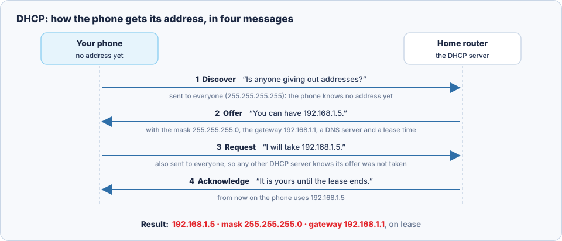

- **Why "to everyone"?** The phone has no address yet and does not know the router's, so it sends its Discover to the broadcast address `255.255.255.255`, which reaches every device on the local network.
- The same exchange also hands over the address of a DNS server (Ep 3).
- The address is on **lease**: lent, not owned. An address that can change like this is a **dynamic IP**. One that stays fixed is a **static IP**.
- If no DHCP server answers, a laptop gives itself an address that starts with `169.254`. Seeing one means "connected to the WiFi, but nobody gave me an address".

## 6. Running out of IPv4 addresses

IPv4's 32 bits make about **430 crore** addresses in all, and whole blocks of them are kept for special uses, so even fewer can be used on the internet.

- IPv4 is a design from **1981**, when the whole network had only a few hundred computers.
- Today India alone has more than **100 crore** mobile connections.
- On **3 February 2011**, IANA gave out its last free blocks of IPv4 addresses. Since then new networks get very small blocks, or buy addresses from others.

And yet the internet keeps working. The reason is hidden in our own address.

> **Beyond the video: addresses now cost money.** Since 1 February 2024, AWS charges 0.005 US dollars an hour for every public IPv4 address, in use or idle: about 44 dollars a year per address. So real systems keep most servers on private addresses (section 7) behind one public entry point.

## 7. Private addresses: why 192.168.1.5 is on lakhs of phones

All addresses that start with `192.168` are kept for one special job: they work **only inside one network**. There are three such blocks, and their addresses are called **private addresses**.

| Block | Range | Addresses |
|---|---|---|
| `10.0.0.0/8` | 10.0.0.0 to 10.255.255.255 | 1,67,77,216 (about 1.7 crore) |
| `172.16.0.0/12` | 172.16.0.0 to 172.31.255.255 | 10,48,576 |
| `192.168.0.0/16` | 192.168.0.0 to 192.168.255.255 | 65,536 |

**Routers on the internet do not forward packets with these addresses.** So any home and any office can reuse them without a conflict. That is why our address is written on lakhs of phones right now, and nothing breaks.

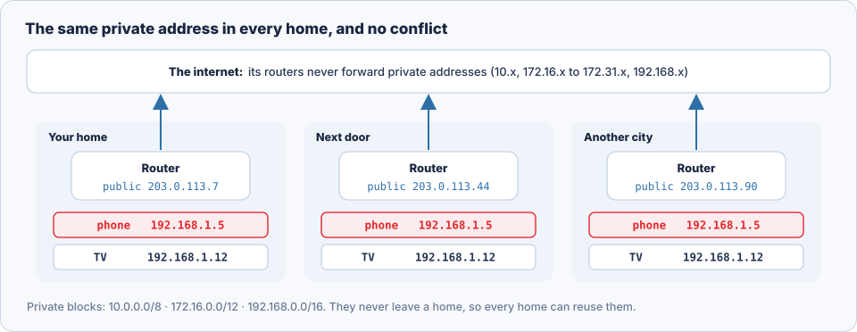

Note that the middle block runs from `172.16` to `172.31` only: addresses from `172.32` on are ordinary public ones.

**The problem this creates.** Remember the packet with our message: its sender is the phone's address, and that address is private. Where should the server send its reply? `192.168.1.5` does not work on the internet at all.

> **Beyond the video: the other special addresses.**
>
> | Block | Meaning |
> |---|---|
> | `127.0.0.0/8` | loopback: "this computer itself" (`127.0.0.1` is localhost) |
> | `169.254.0.0/16` | link-local: self-assigned when DHCP fails |
> | `100.64.0.0/10` | shared space for carrier-grade NAT (section 10) |
> | `0.0.0.0` | "no address yet" to a device; "every address I have" to a server |
> | `255.255.255.255` | broadcast to the whole local network |
> | `192.0.2.0/24`, `198.51.100.0/24`, `203.0.113.0/24` | only for documentation and examples, like these notes |

## 8. NAT: sharing one public address

The solution sits in your router. It has **two addresses**:

- inside, a private one: `192.168.1.1`;
- outside, a **public** one that the ISP gave it, which nobody else on the internet has: `203.0.113.7`.

When a packet leaves the home, the router **removes the sender's private address and writes its own public address** in its place. In our example the sender changes from `192.168.1.5` to `203.0.113.7`. The server thinks the router sent the request, and sends its reply to the router.

This method is **NAT**: Network Address Translation.

**The video's second question.** In the same second, the second phone at home (`192.168.1.8`) also sends a message to the same chat server. Both replies come back to the router, and both are addressed to `203.0.113.7`. How does the router decide which reply belongs to which phone?

- A: The server wrote the phone's private address on the reply.
- B: The router remembered which phone asked which server.
- C: Another number went with each request, and the router noted it.

The answer is **C**: both phones talk to the same server, so the router needs a number that is different for every request.

**Ports.** Besides the address, every packet carries a second number: the **port**. A port is 16 bits, so it goes from 0 to 65,535, and the phone picks one when it sends.

The router keeps a **NAT table**: the inside address, its port, and the port used outside.

| Inside address : port | Outside address : port |
|---|---|
| 192.168.1.5 : 51000 | 203.0.113.7 : 51000 |
| 192.168.1.8 : 49200 | 203.0.113.7 : 49200 |

A reply to port 51000 belongs to the first phone; a reply to port 49200 to the second.

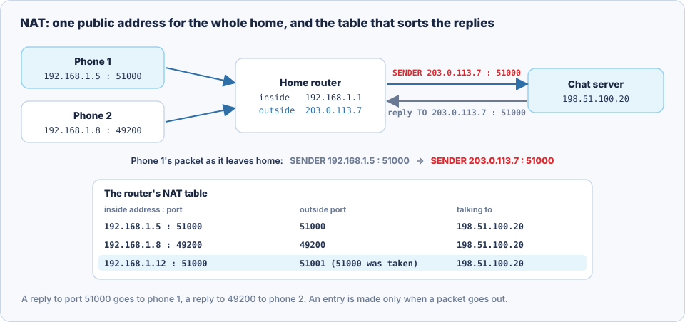

> **Beyond the video: the same port twice.** If two devices happen to pick the same port, the router gives one of them a different outside port and writes that in the table too, so every outside port still leads to exactly one device. This port-swapping kind of NAT is what every home router does; the standard calls it **NAPT** (Network Address Port Translation). Ports get their own episode later in the series.

## 9. The cost of NAT: conversations start from inside

The NAT table has a cost.

- An entry is made automatically **only when a packet goes out** from inside.
- If someone outside tries to reach your phone on their own, the table has no entry for them, and the router does not forward their packet.
- So a conversation **always starts from inside**.

That is why a **server** needs its own **public** address, and one that does not change: a **static IP**. Everybody starts conversations with the server, so it must be reachable at a fixed place.

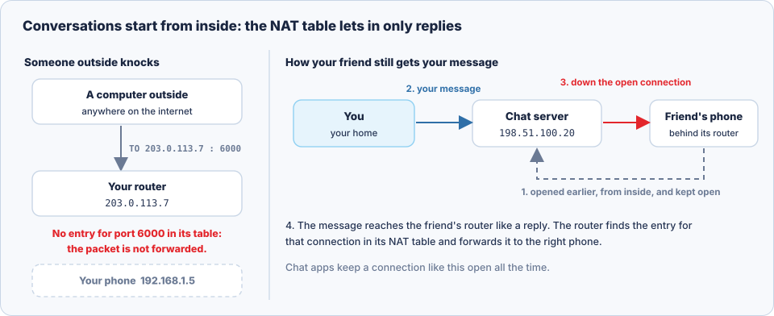

> **Beyond the video: then how does your friend get your message?** Your friend's phone is also behind a router, and nobody outside can start a conversation with it. The trick: the friend's phone has already opened a connection to the chat server **from inside**, and keeps it open. The chat server sends your message down that open connection, as if it were a reply. The friend's router finds the entry in its NAT table and forwards the message to the right phone. Chat apps keep a connection like this open all the time; real-time messaging gets its own episode later.

> **Beyond the video: hosting from home.** To run a game server at home, people add a **port forward**: a manual entry in their router's NAT table that sends one outside port to one device inside. It works only when the router holds a real public address (see carrier-grade NAT, section 10).

## 10. One public address, many people

**A building.** 100 homes with 10 devices each (phones, laptops, a TV): 1,000 devices.

- Without NAT, every device needs its own public address: **1,000** public addresses.
- With NAT, each home needs only one, for its router: **100**.

The devices inside use private addresses, and the same private addresses are reused in every home. That is how far more devices than 430 crore get online. But NAT did not remove the 430 crore limit; it only fits more devices inside it.

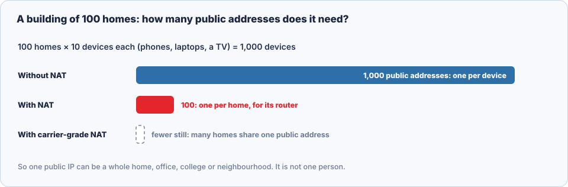

**What this means for system design: one public IP address is not one person.** Behind it there can be a whole home, a whole office or a whole college.

**Carrier-grade NAT.** ISPs ran short of public addresses too, so many of them run a second, much bigger NAT inside their own network: **carrier-grade NAT (CGNAT)**. Your router's outside address may then come from the shared block `100.64.0.0/10`, and the real public address is shared with many other customers. Mobile networks often work this way.

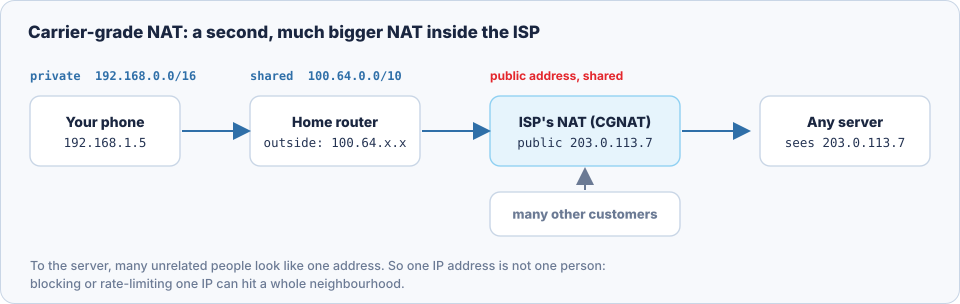

When you design a system:

- **Do not block or rate-limit by IP alone.** Block one address and you may block a whole college or neighbourhood. Cloudflare measured that addresses behind carrier-grade NAT get rate-limited about three times as often as other addresses.
- The "are you a robot?" check you sometimes get on shared WiFi often comes from somebody else on the same address sending automated searches.
- The same person also shows up from different addresses: moving from WiFi to mobile data changes the public address.
- Identify users by their account after login, and treat the IP address only as a hint.

## 11. IPv6

There is only one way to remove the limit: **more bits**. In **IPv6**, Internet Protocol version 6, an address is **128 bits** long.

- Total addresses: 2¹²⁸ = 340,282,366,920,938,463,463,374,607,431,768,211,456 ≈ **3.4 × 10³⁸**: 34 followed by 37 zeros.
- With that many, every device can have its own public address, and the address-swapping table of NAT is not needed.
- The internet cannot change in a day, so today IPv4 and IPv6 run side by side. Most phones and laptops have both kinds of address.

> **Beyond the video: 4 times the bits is not 4 times the addresses.** 32 bits to 128 bits is 4 times the bits. But every extra bit doubles the count (Ep 1), and there are 96 extra bits, so IPv6 has 2⁹⁶ times as many addresses as IPv4: about 7.9 × 10²⁸ times.

> **Beyond the video: how an IPv6 address is written.**
>
> - In **hexadecimal**: each digit holds 4 bits and runs 0 to 9, then a to f (10 to 15).
> - Eight groups of four hex digits (16 bits each), separated by colons: 8 × 16 = 128 bits.
> - Leading zeros in a group can be dropped, and one run of all-zero groups can be written as `::` (only once per address). So `2001:0db8:85a3:0000:0000:8a2e:0370:7334` becomes `2001:db8:85a3::8a2e:370:7334`.
> - Usually the first 64 bits are the network and the last 64 the device. A single home network gets 2⁶⁴ addresses: the whole IPv4 internet, 430 crore times over.
> - Without NAT, a device can in principle be reached from outside, so blocking uninvited traffic becomes the job of the router's **firewall**. It is usually on, but not on every router.

> **Beyond the video: India and IPv6.** About 3 in 4 users in India already reach Google over IPv6 (73.48 % on 10 November 2026), one of the highest shares in the world.

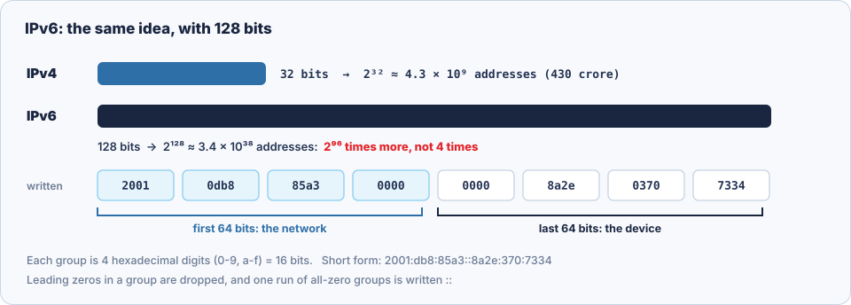

| | IPv4 | IPv6 |
|---|---|---|
| Size | 32 bits | 128 bits |
| Addresses | 2³² ≈ 4.3 × 10⁹ (430 crore) | 2¹²⁸ ≈ 3.4 × 10³⁸ |
| Written as | 4 decimal numbers with dots | 8 hexadecimal groups with colons |
| Example | `192.168.1.5` | `2001:db8:85a3::8a2e:370:7334` |
| Sharing addresses | NAT is everywhere | not needed |
| A home network gets | usually 1 public address | usually 2⁶⁴ addresses |

## 12. Interview questions

Each question says where it comes from:

- **Reported**: a candidate wrote publicly that they were asked it. It does not mean the company still asks it.
- **Common topic**: it appears on many interview preparation lists.
- **Our question**: written by us to test the idea.

The two questions inside the video, about /24 (254 devices) and the two phones (ports), are answered in sections 3 and 8. The first four below are the video's interview round. Try each one before you read the answer.

### From the video

**1. Can you open amazon.com with only a private IP address?**

*Reported · Amazon · Cloud Support Associate, campus · LeetCode Discuss, Nov 2019.*

Not directly. Routers on the internet do not forward packets with a private address, so something in between, a NAT, must replace it with a public address. Your home router does exactly this every time you open a website.

**2. How many bits is an IPv4 address, and an IPv6 address?**

*Common topic · IPv4 vs IPv6.* It is on the interview lists of PyNet Labs, PlacementPreparation and GeeksforGeeks.

32 and 128. Two follow-ups you may get:

- *Why do we need IPv6 if we have IPv4?* (Reported · Cisco · Technical Consulting Engineer, campus · GeeksforGeeks, updated 11 Aug 2021.) 32 bits give only about 430 crore addresses, and IANA's free pool ran out in 2011. 128 bits remove the limit.
- *Why does IPv6 not need NAT?* Every device can have its own public address; a firewall, not NAT, keeps uninvited traffic out.

**3. For `192.168.233.145/27`, find the network address and the broadcast address.**

*Reported · Cisco · Advisory Services, campus · GeeksforGeeks.*

`192.168.233.128` and `192.168.233.159`. Write the last number in bits: 145 = 128 + 16 + 1 = `100 10001`. /27 draws the line after the first 3 bits of the last number. Device bits all 0: `100 00000` = 128, the network address. All 1: `100 11111` = 159, the broadcast address. The devices are `.129` to `.158`: 30 of them. (The bit method, step by step, is in section 4.)

**4. Lots of requests reach your app from one IP address. What can go wrong if you block it?**

*Our question · system design.*

NAT. Behind that one address there can be a whole home, office or college, or with carrier-grade NAT many homes, so innocent users get blocked too. Meanwhile one attacker can simply move to other addresses. Better: limit by account or API key first, and keep an IP limit only as a loose outer limit. On IPv6, limit by the /64 block, not by the single address, because one home owns a whole /64.

### More practice

**5. Are two addresses in the same network? Write it as code.**

*Reported · Cisco Meraki · SDE internship 2023 · GeeksforGeeks, updated 8 Feb 2023.* It was asked with bit operations.

AND both addresses with the mask, and compare:

```python
def ip_to_int(ip: str) -> int:
    a, b, c, d = (int(x) for x in ip.split("."))
    return (a << 24) | (b << 16) | (c << 8) | d

def same_network(a: str, b: str, prefix: int) -> bool:
    mask = (0xFFFFFFFF << (32 - prefix)) & 0xFFFFFFFF   # prefix ones, then zeros
    return (ip_to_int(a) & mask) == (ip_to_int(b) & mask)

print(same_network("192.168.1.5", "192.168.1.12", 24))    # True: the TV
print(same_network("192.168.1.5", "198.51.100.20", 24))   # False: the server
```

**6. Write the NAT table of a home router.**

*Reported · Cisco Meraki · SDE internship 2023 · GeeksforGeeks, updated 8 Feb 2023* (the next round of the same interview).

Keep two maps: inside address and port → outside port for packets going out, and outside port → inside address and port for replies coming in. Make an entry only when a packet goes out; drop an incoming packet that has no entry.

```python
class Nat:
    def __init__(self, public_ip: str):
        self.public_ip = public_ip
        self.out = {}    # (inside address, inside port) -> outside port
        self.back = {}   # outside port -> (inside address, inside port)

    def outgoing(self, ip: str, port: int):
        """A packet leaves the home: returns the sender it carries outside."""
        key = (ip, port)
        if key not in self.out:
            outside = port
            while outside in self.back:      # taken by another device: try the next port
                outside += 1
            self.out[key] = outside
            self.back[outside] = key
        return self.public_ip, self.out[key]

    def incoming(self, port: int):
        """A packet reaches the public address: returns who gets it, or None (dropped)."""
        return self.back.get(port)

nat = Nat("203.0.113.7")
print(nat.outgoing("192.168.1.5", 51000))    # ('203.0.113.7', 51000)
print(nat.outgoing("192.168.1.12", 51000))   # ('203.0.113.7', 51001): 51000 was taken
print(nat.incoming(51000))                   # ('192.168.1.5', 51000)
print(nat.incoming(6000))                    # None: no entry, so it is not forwarded
```

A real router also stores the server's address and port, removes entries after some idle time, and stays inside the 0 to 65,535 range.

**7. A phone has just joined WiFi. How does it find the DHCP server?**

*Reported · Juniper Networks · GeeksforGeeks, updated 7 May 2024.*

It does not need to know it. It broadcasts a Discover to `255.255.255.255`; every device on the network hears it, and the DHCP server answers with an Offer. Then come Request and Acknowledge: DORA.

**8. A firewall rule denies `10.5.12.10/28`. Is a request from `10.5.12.14` denied?**

*Reported by 2 candidates · Databricks · LeetCode Discuss.* Both were asked to code allow and deny rules.

Yes. /28 leaves 4 device bits: blocks of 16. AND the rule's address with the mask: `10.5.12.10` becomes `10.5.12.0`, so the rule covers `10.5.12.0` to `10.5.12.15`, and `.14` is inside it. The trap: the rule is written with `.10`, but it covers its whole block from `.0`.

**9. A network needs 32 devices. How many device bits does it need, at least?**

*Our question,* built on a subnetting question reported from the same Amazon interview as question 1.

6. Five bits make 32 addresses, but two of them (the network and the broadcast address) cannot go to devices, so 32 devices need 34 addresses. 6 bits make 64: a /26.

## 13. Try it yourself

1. **Your mask and gateway.** On your phone, open the details of the WiFi network you are on: you will find the IP address, the subnet mask (often `255.255.255.0`) and the gateway or router (often `192.168.1.1` or `192.168.0.1`). On Windows, run `ipconfig /all`; on a Mac, `ipconfig getpacket en0` shows the whole DHCP answer, lease time included.
2. **Check your subnet answers with Python.** Its built-in `ipaddress` module does the AND for you:

```python
import ipaddress
n = ipaddress.ip_network("192.168.233.145/27", strict=False)
print(n, n.broadcast_address, n.num_addresses)   # 192.168.233.128/27 192.168.233.159 32
```

3. **Two networks, two public addresses.** On WiFi, open a "what is my IP" page and note the address (a long one with colons is IPv6). Switch to mobile data and reload. The address changes: you are now behind a different router.
4. **Is there a second NAT above your router?** Find your public IPv4 address (on a laptop: `curl -4 ifconfig.me`) and compare it with the "WAN IP" on your router's status page.
    - The same: your router holds a public address.
    - The WAN IP starts with `100.64` to `100.127`, `10`, `172.16` to `172.31` or `192.168`: there is another NAT above you.

## 14. One-page revision

- Mask: 32 bits, 1 = network bit, 0 = device bit. /24 = 255.255.255.0 = 24 ones.
- AND: a mask 1 keeps the bit, a mask 0 makes it 0. Address AND mask = the network address.
- Same network? AND both addresses with the mask and compare. Different: send to the gateway, the home router.
- n device bits: 2ⁿ addresses, 2ⁿ − 2 for devices. /24 → 254. Network address = all 0s, broadcast = all 1s.
- Block size in the last number = 256 − the mask number. /27 → 32, so .145/27 is in .128 to .159.
- Subnetting: every extra network bit doubles the subnets and halves their size. /25 = .128, /26 = .192, /27 = .224.
- Network and broadcast of any address: write the last number in bits, draw the mask's line, set the device bits to all 0 (network) or all 1 (broadcast). 145/27: `100 10001` → 128 and 159.
- An address alone is incomplete: the address and the mask together say which network it is in.
- DHCP = Discover, Offer, Request, Acknowledge. Address, mask, gateway and DNS server, on lease.
- IPv4: about 430 crore addresses; IANA's free pool ran out on 3 Feb 2011.
- Private: 10/8, 172.16/12, 192.168/16. Never forwarded on the internet, so reused everywhere.
- NAT: private sender → the router's public address; the NAT table's ports send replies back. Conversations start from inside; servers need a static public IP.
- One IP is not one person (NAT, carrier-grade NAT in 100.64/10). Limit by account, not by IP alone.
- IPv6: 128 bits, 2¹²⁸ ≈ 3.4 × 10³⁸, hexadecimal, usually a /64 per network, no NAT needed. Runs beside IPv4.
- Next: DNS, how a name such as a website's becomes an IP address.

## Sources

- The local-or-gateway decision, network and broadcast addresses: [RFC 1122](https://www.rfc-editor.org/rfc/rfc1122.html) · CIDR and prefixes: [RFC 4632](https://www.rfc-editor.org/rfc/rfc4632.html) · /31 links: [RFC 3021](https://www.rfc-editor.org/rfc/rfc3021.html)
- DHCP: [RFC 2131](https://www.rfc-editor.org/rfc/rfc2131.html) · Link-local addresses: [RFC 3927](https://www.rfc-editor.org/rfc/rfc3927.html)
- Private addresses: [RFC 1918](https://www.rfc-editor.org/rfc/rfc1918.html) · Special addresses: [IANA registry](https://www.iana.org/assignments/iana-ipv4-special-registry/iana-ipv4-special-registry.xhtml) · Shared space for carrier-grade NAT: [RFC 6598](https://www.rfc-editor.org/rfc/rfc6598.html)
- NAT and NAPT: [RFC 3022](https://www.rfc-editor.org/rfc/rfc3022.html) · Ports are 16 bits: [RFC 9293](https://www.rfc-editor.org/rfc/rfc9293.html), [RFC 768](https://www.rfc-editor.org/rfc/rfc768.html)
- IPv4 in 1981: [RFC 791](https://www.rfc-editor.org/rfc/rfc791.html) · Hosts on the network in August 1981: [RFC 1296](https://www.rfc-editor.org/rfc/rfc1296.html) · IANA's pool running out: [NRO](https://www.nro.net/ipv4-free-pool-depleted) · India's mobile connections: [TRAI press release 140/2026](https://trai.gov.in/sites/default/files/2026-10/PR_No140of2026.pdf)
- IPv6 addressing: [RFC 4291](https://www.rfc-editor.org/rfc/rfc4291.html) · How it is written: [RFC 5952](https://www.rfc-editor.org/rfc/rfc5952.html) · A /64 per network: [RFC 7421](https://www.rfc-editor.org/rfc/rfc7421.html) · Home router firewalls: [RFC 6092](https://www.rfc-editor.org/rfc/rfc6092.html) · IPv4 and IPv6 side by side: [RFC 4213](https://www.rfc-editor.org/rfc/rfc4213.html) · IPv6 in India: [Google IPv6 statistics](https://www.google.com/intl/en/ipv6/statistics.html) (data of 10 November 2026)
- Cloud networks: [AWS subnet sizing](https://docs.aws.amazon.com/vpc/latest/userguide/subnet-sizing.html) · [AWS VPC blocks](https://docs.aws.amazon.com/vpc/latest/userguide/vpc-cidr-blocks.html) · [Azure virtual network FAQ](https://learn.microsoft.com/en-us/azure/virtual-network/virtual-networks-faq) · [AWS public IPv4 charge](https://aws.amazon.com/blogs/aws/new-aws-public-ipv4-address-charge-public-ip-insights/)
- Shared addresses and rate limits: [Cloudflare, 29 October 2025](https://blog.cloudflare.com/detecting-cgn-to-reduce-collateral-damage/) · The robot check on shared networks: [Google Search Help](https://support.google.com/websearch/answer/86640)
- Interview write-ups: [Amazon](https://leetcode.com/discuss/interview-experience/427355/) · [Cisco Advisory Services](https://www.geeksforgeeks.org/interview-experiences/cisco-interview-experience-set-16-campus-advisory-services/) · [Cisco campus](https://www.geeksforgeeks.org/interview-experiences/cisco-interview-experience-on-campus-5/) · [Cisco Meraki](https://www.geeksforgeeks.org/interview-experiences/cisco-meraki-interview-experience-for-sde-internship-2023/) · [Juniper Networks](https://www.geeksforgeeks.org/interview-experiences/juniper-networks-interview-experience-3/) · Databricks [1](https://leetcode.com/discuss/interview-question/5743277/) · [2](https://leetcode.com/discuss/post/6479010/) · IPv4 vs IPv6 lists: [PyNet Labs](https://www.pynetlabs.com/networking-interview-questions-and-answers/) · [PlacementPreparation](https://www.placementpreparation.io/blog/networking-interview-questions-for-freshers/) · [GeeksforGeeks](https://www.geeksforgeeks.org/computer-networks/networking-interview-questions/)
