# Episode 3: DNS (Domain Name System)

**System Design (Hindi) · Code Man**

These are the notes for Episode 3. The video explains everything step by step in Hindi; these notes follow the same path in simple English, go a little deeper, and are made to be revised quickly before an interview. Boxes marked **Beyond the video** are extra material the video had no time for.

- Video: [Who Controls Every Domain on the Internet?](https://youtu.be/TAeHMpvWGFA) (public from Thu 19 Nov, 8:00 PM IST)
- PDF of these notes: [ep03-dns.pdf](ep03-dns.pdf)
- Previous episode: [Ep 2: Subnet Mask, Private IP & NAT](../ep02-subnet-mask-nat/README.md) · Next: Ep 4

**The names in these notes.** `youtube.com` and `google.com` are real, and so are ICANN, Verisign, GoDaddy, Hostinger, Cloudflare, Jio and Airtel. `codeman.com` is only a "**suppose I bought it**" example: the real `codeman.com` belongs to someone else, so we never show its real address. Our imaginary servers use `203.0.113.x`, an address range kept for documentation ([RFC 5737](https://www.rfc-editor.org/rfc/rfc5737.html)), and `2001:db8::` for IPv6 ([RFC 3849](https://www.rfc-editor.org/rfc/rfc3849.html)). Addresses of real companies are shown only in part, like `142.250.x.x`, except the two public resolvers `8.8.8.8` and `1.1.1.1`.

## In one minute

- Packets travel to **addresses**, never to names. **DNS** (Domain Name System) is the internet's contact list: it turns `youtube.com` into an IP address.
- At first the list was **one file**, `HOSTS.TXT`, kept by one office in California, the **NIC**, and copied by every computer. It broke as the network grew. Since 1983 the list is split into many small lists, each kept by a different owner.
- Read a name from the right: the **root** (a hidden dot), then the **TLD** (`.com`), then the domain (`codeman.com`), then a subdomain (`blog`). **ICANN** keeps the **root list** of all 1,436 TLDs. Each TLD's list is kept by a **registry** (Verisign for `.com`).
- You buy a domain from a **registrar** (GoDaddy, Hostinger). The registrar tells the registry which **name servers** hold your own list. The registry's row, `codeman.com. 172800 IN NS ns51.domaincontrol.com.`, only says *who to ask next*. The real address is in your list, on your name servers.
- Your phone asks a **resolver** (usually your ISP's) once and wants the whole answer: a **recursive** query. The resolver asks **root → registry → name server** one by one, and each only points to the next: **iterative** queries with **referrals**. A first lookup takes three trips.
- The resolver already knows the root: 13 names (A to M), run by 12 organisations, with 2,000+ copies behind them reached by **anycast** (the nearest copy answers).
- A name server's list is made of **records**: A (IPv4 address), AAAA (IPv6 address), CNAME (another name), MX (mail), TXT (text), NS (name servers).
- Answers are **cached** for as long as the record's **TTL** (Time To Live, in seconds) says. That is why a name-server change can take up to **48 hours**: the row had a TTL of 1,72,800 seconds. Before a planned move, lower the TTL a day or more ahead.
- DNS can answer by place, rotate addresses and drop a dead server, but it hands out an address once and does not see each request: that is not the job of a **load balancer**.
- If DNS itself cannot be reached, a perfectly healthy service disappears: Facebook, Instagram and WhatsApp, 4 October 2021, about 6 hours.

## 0. Where Ep 2 left off

- Ep 1 and Ep 2 followed one message from your phone, `192.168.1.5`, at home on WiFi. Every packet carries a sender **address** and a receiver **address**. ([Ep 1](../ep01-ip-address/README.md), [Ep 2](../ep02-subnet-mask-nat/README.md))
- The home router swaps the private sender address for its public one (NAT).
- DHCP, in Ep 2, also handed the phone the address of a **DNS server**. We left that for this episode.

But you never type an address. You type `youtube.com`. The open question: how does the phone get the IP address of YouTube's server from that name?

## 1. Why we need DNS

- Data travels in small **packets**, and every packet goes to an **address** ([RFC 791](https://www.rfc-editor.org/rfc/rfc791.html)). A name means nothing to a router.
- People remember names; machines use numbers. Compare your phone's contact list: you look for "Mummy", and the call goes to her number.
- The internet needs such a list too, and it is called **DNS**: **Domain Name System**. A **domain name** is a name like `youtube.com`.
- The list is huge: more than **41 crore** domain names are registered (411.6 million in the third quarter of 2026).

The video asks three questions about this list. Where is it kept? Who controls it? How does your phone get an answer in a few milliseconds? The rest of these notes answers them in that order.

A name also lets you **move**. The server's address can change next week, and nobody has to learn a new one: only the list is updated.

## 2. The old way: one file, HOSTS.TXT

Start from the beginning. In the **1970s** the first form of the internet was **ARPANET**: a network of the American government that connected a few hundred computers of universities and research labs.

At that time the contact list really was **one file**, called `HOSTS.TXT`. Each line had one computer: its **name** and its **address**.

- **One office made it.** The file was made in one place in the world: the **NIC** (**Network Information Center**) at **SRI**, a research institute in **Menlo Park, California**. SRI was the office, the NIC was the team in it that kept the list.
- **To add a computer, you sent an email.** The owner of a new computer wrote to the NIC (the address for such requests was `HOSTMASTER@SRI-NIC.ARPA`), and the NIC added a line.
- **Every computer copied the whole file.** The NIC built a new file once or twice a week, and every computer on the network downloaded it from the NIC's computer.

While there were a few hundred computers, this worked. In the **1980s** there were thousands, and the method broke ([RFC 1034 §2.1](https://www.rfc-editor.org/rfc/rfc1034.html)):

- the file got bigger and bigger;
- a new name needed days to reach everyone, and organisations had to wait for the NIC;
- thousands of computers kept downloading the whole file from the same office, and that load grew faster than the number of computers.

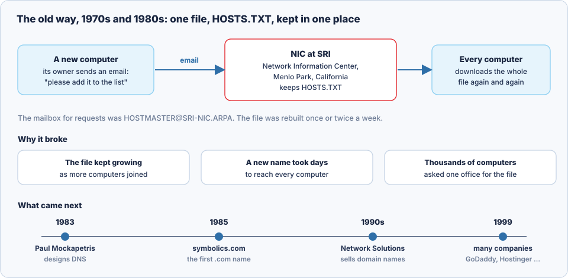

**What came next.**

- **1983**: Paul Mockapetris designed a new system: not one big file, but many small lists, each kept by a different owner. This is DNS ([RFC 882](https://www.rfc-editor.org/rfc/rfc882.html) and [RFC 883](https://www.rfc-editor.org/rfc/rfc883.html)).
- **1985**: the first `.com` name was registered: `symbolics.com`. Names still came from the same NIC office.
- **1990s**: the work of selling names went to a company called **Network Solutions**.
- **From 1999**: many companies could sell domain names. Today's examples are GoDaddy and Hostinger.

> **Beyond the video: the hosts file still exists.** Every laptop still has a small file called `hosts` that is read **before** DNS: it is `/etc/hosts` on Mac and Linux. A line like `127.0.0.1  localhost` there is why the name `localhost` always works.

## 3. Reading a name: root, TLD, domain, subdomain

How the lists are divided is written in the name itself. **Read a name from the right side.**

- The **last** word, `com` in `youtube.com`, is the **TLD**: **Top-Level Domain**. `.com`, `.in`, `.org` and `.net` are TLDs. There are **1,436** today (IANA list of 15 November 2026).
- After `com` there is one more dot, which we never type. To its right there is nothing: it is the top level of all, the **root**. The complete name is really `youtube.com.` with a dot at the end ([RFC 1034 §3.1](https://www.rfc-editor.org/rfc/rfc1034.html)).
- To the left of the TLD is the name you choose and buy: `youtube`, or in our example `codeman`.
- A name to the left of that is a **subdomain**: `blog` in `blog.codeman.com`.
- At every level, the name from there to the right is a **domain**: `com`, `codeman.com`, `blog.codeman.com`.

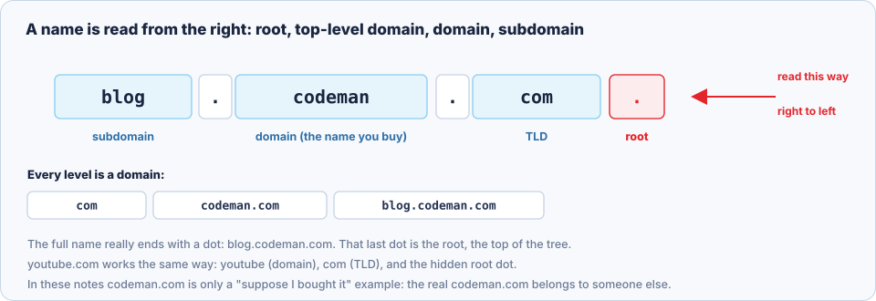

## 4. Who controls DNS: ICANN, the root list and the registries

**Who decides which TLDs exist?** **ICANN** (**Internet Corporation for Assigned Names and Numbers**), an American non-profit organisation formed in **1998**.

- ICANN has a list of every TLD in the world (1,436 today). Next to each TLD it says which servers hold that TLD's own list. This is the **root list**.
- The practical work of keeping the root list (called the IANA functions) is done by an ICANN affiliate, **PTI** (Public Technical Identifiers). A company called Verisign then applies the changes and sends the new root list to the root servers (section 8).

**How do I get my own TLD?** Suppose you want `.codeman`. You apply to ICANN, in a round when applications are open, and pay a fee.

- **2012 round**: about **1,930 applications**, and a fee of **USD 1,85,000** for each.
- Google took TLDs of its own in that round, such as `.google` and `.youtube`. Both are Google's own TLDs, so Google is the registry for them.
- **2026 round**: applications were open from 30 April to 12 August 2026, and the fee is **USD 2,27,000** each: about **2 crore rupees** (at about ₹88 per dollar). More than 1,600 applications came.

**Country TLDs.** Every country also has its own TLD. India's is `.in`, managed by **NIXI** (**National Internet Exchange of India**), according to the IANA root zone database.

**Registry.** Each TLD has its own list, kept by one company or organisation: the **registry** of that TLD.

- The registry of `.com` is **Verisign**, an American company. Every `.com` domain in the world is one entry in Verisign's list. There are about **17 crore** `.com` domains (169.8 million in the third quarter of 2026).
- The registry of `.in` is NIXI.

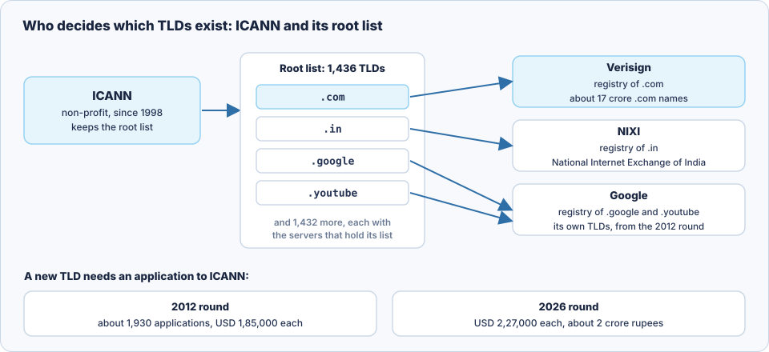

> **Beyond the video: who edits the root list.** ICANN, through PTI, decides what the root list contains. Verisign, as the **Root Zone Maintainer**, applies the changes, makes the new file and sends it to the root server operators ([ICANN–Verisign agreement, 2016](https://icann.org/iana_imp_docs/63-root-zone-maintainer-agreement-v-1-0)). One group decides, another publishes: nobody can change the root alone.

## 5. Buying a domain: registrar, registry and name server

Now how does a new domain reach this list? **Suppose** I buy `codeman.com` for my website.

1. **I do not go to Verisign.** I go to a company like GoDaddy, Hostinger or Namecheap. Such a company is a **registrar**: a company approved by ICANN to sell domains.
2. I search `codeman.com` on GoDaddy. GoDaddy asks Verisign whether the name is free. It is, and I pay for one year.
3. **The money.** Of the price, about **USD 11** goes to Verisign (USD 10.97 since 1 November 2026) and about **20 cents** to ICANN. The rest is GoDaddy's. These amounts change over time.
4. **What GoDaddy keeps:** its own record about me: the domain is mine, until which date it is paid, and where to send the bill.
5. **What GoDaddy tells Verisign:** the list of `codeman.com` will be on GoDaddy's two servers, `ns51.domaincontrol.com` and `ns52.domaincontrol.com`. (`domaincontrol.com` is GoDaddy's own domain. The numbers 51 and 52 are just an example; every customer gets a pair.)
6. Servers that hold the real list of a domain are called **name servers**.
7. **Why two?** So that if one stops, the other answers. Both hold exactly the same list.

So three different companies do three different jobs:

| Who | Job | What it stores |
|---|---|---|
| **Registrar** (GoDaddy) | sells you the domain | that the domain is yours, until when, where to send the bill |
| **Registry** (Verisign) | keeps the TLD's list | for `codeman.com`: only its name servers. **No IP address** |
| **Name server** (GoDaddy's `ns51` and `ns52`) | keeps your own list | the records of the domain: the IP addresses, mail, and so on |

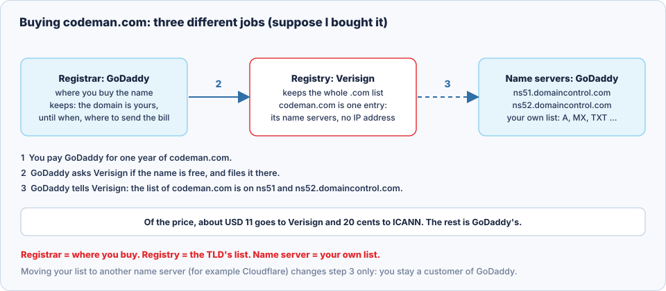

A simple way to remember: **registrar = where you buy · registry = the TLD's list · name server = your own list.**

> **Beyond the video: how the registrar talks to the registry.** Registrars and registries talk through a standard protocol called **EPP** (**Extensible Provisioning Protocol**, [RFC 5730](https://www.rfc-editor.org/rfc/rfc5730.html)). The registry holds the registration data (the registrar, the dates, the status, the name servers). The DNS records themselves (A, MX, TXT) are not there: they live on the name servers.

## 6. The row in the .com list, column by column

Verisign's list gets a new line for `codeman.com`. It is a **DNS record** (more in section 10), and it looks like this:

```text
codeman.com.   172800   IN   NS   ns51.domaincontrol.com.
codeman.com.   172800   IN   NS   ns52.domaincontrol.com.
```

Read the first row from the left, one column at a time:

| # | Column | Here | Meaning |
|---|---|---|---|
| 1 | **Name** | `codeman.com.` | the name this row is about (with the hidden root dot at the end) |
| 2 | **TTL** (Time To Live) | `172800` | seconds. Whoever reads this row may **remember it for this long**. 1,72,800 seconds ÷ 60 ÷ 60 ÷ 24 = **2 days** |
| 3 | **Class** | `IN` | always `IN`, for Internet. An old field that never changes |
| 4 | **Type** | `NS` | **Name Server**: this row says which server holds the list of this name |
| 5 | **Value** | `ns51.domaincontrol.com.` | that server: a GoDaddy name server |

There is a second row for `ns52`: it is the second name server, the backup.

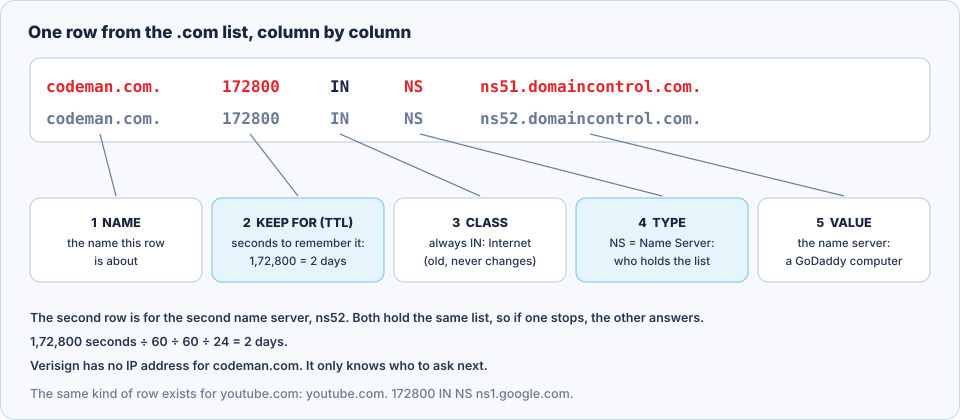

Notice what is **not** here: Verisign has **no IP address** for `codeman.com`. It only knows who holds the list. The same kind of row exists for YouTube: `youtube.com. 172800 IN NS ns1.google.com.` (checked live on 15 November 2026). It points to Google's own four name servers, `ns1.google.com` to `ns4.google.com`. Google is big enough to keep its list on its own servers, not on a registrar's.

The number 1,72,800 comes back in section 11.

## 7. Your own list: records, subdomains, changing name servers

The real list of `codeman.com` is on GoDaddy's name servers, and I edit it on GoDaddy's website, on the **DNS page**. (Hostinger and others have the same kind of page.)

- I write a row: `codeman.com` → the IP address of my website's server. Suppose `203.0.113.10`.
- I want the blog on another server, so I write one more row: `blog.codeman.com` → the blog server's address, suppose `203.0.113.20`.
- `blog.codeman.com` is a **subdomain**: a name made inside `codeman.com`.
- A subdomain needs **nothing new to buy**. I can make as many as I want, such as `shop.codeman.com` or `api.codeman.com`. Each is one more row in my own list.

**Changing the name servers.** Suppose tomorrow I want to keep my list at **Cloudflare**, not GoDaddy. Cloudflare gives me two name servers for my domain (names of the form `<name>.ns.cloudflare.com`, [Cloudflare docs](https://developers.cloudflare.com/dns/zone-setups/full-setup/setup/)).

1. On GoDaddy's page I remove GoDaddy's two name servers and enter Cloudflare's two.
2. GoDaddy tells Verisign. Verisign writes the new name servers in its row.
3. From now on the list of `codeman.com` is on Cloudflare's servers.

The **domain** is still GoDaddy's: I still renew it there. Only the **list** moved. This is why registrar and name server are two different jobs.

## 8. The 13 .com servers and the 13 root names

**Where is Verisign's `.com` list kept?** The root list knows. For `.com` it holds not one server but **13**, named `a.gtld-servers.net` to `m.gtld-servers.net`. (`gTLD` means generic TLD, a TLD like `.com` that is not for one country.)

- All 13 belong to Verisign.
- All 13 hold **exactly the same list**: not 13 different lists, but 13 copies of one list.
- Thirteen so that the world's `.com` names keep working even if some of them are down. Each of them also has copies in many cities.

**Where is the root list kept?** On the **root servers**. They too have 13 names, `a.root-servers.net` to `m.root-servers.net`.

- The letters A to M are **just names**, like counters A, B, C in a bank. They have nothing to do with domains that begin with A or M. Every one of them holds the **whole, same** root list.
- **12 organisations** run the 13: Verisign runs two (A and J), and the others are universities, companies, NASA, parts of the American defence department and army, ICANN itself, and organisations of Europe and Japan.

| Letter | Operator | Letter | Operator |
|---|---|---|---|
| A | Verisign | H | US Army Research Lab |
| B | USC-ISI (a university institute) | I | Netnod |
| C | Cogent | J | Verisign |
| D | University of Maryland | K | RIPE NCC |
| E | NASA | L | ICANN |
| F | ISC (Internet Systems Consortium) | M | WIDE Project |
| G | US Department of Defense | | |

**One name is not one computer.** There are **2,046 copies** of the root servers in the world (15 November 2026), and more than 60 are in India. Every copy of a name uses the **same IP address**. This trick is **anycast**: the internet's routers send your packet to the **nearest** copy of that address ([RFC 9499](https://www.rfc-editor.org/rfc/rfc9499.html)). So your question goes by itself to a copy close to you. "Nearest" means nearest by internet routing, which is usually, not always, the closest in kilometres.

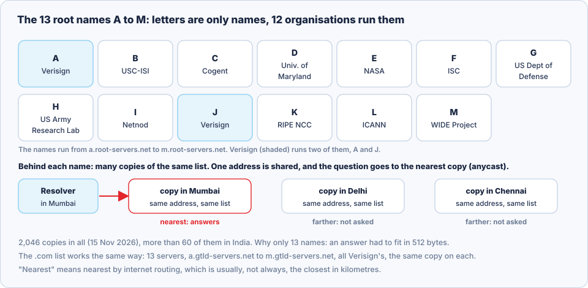

**Why only 13 names?** In the early rules of DNS an answer had to fit in **512 bytes**, and only the names and addresses of 13 servers could fit in one answer (ICANN's [RSSAC FAQ](https://www.icann.org/resources/pages/rssac-faq-2018-03-05-en)). Anycast let the number of machines grow without growing the number of names.

**How does the resolver know the root?** Nobody tells it. The list of the 13 root names and their addresses is written into the resolver's software in advance: the **root hints** ([the current file](https://www.internic.net/domain/named.root)). When a resolver starts, it asks one of them for the up-to-date list of root servers. This first step is called **priming**.

## 9. The lookup: a conversation, hop by hop

Now put everything together. You are at home, the phone is on WiFi, and you open `blog.codeman.com`.

**Step 0: the phone's own memory.** First the phone checks its own cache: "did I ask for this address recently?" No. (The browser has a cache too.)

**Step 1: the phone asks the resolver.** The phone asks a server called the **resolver**. It is often your internet company's, such as Jio or Airtel. The phone got the resolver's address when it joined the WiFi: DHCP (Ep 2) handed it over together with the phone's own address and the mask. You can also choose a public resolver in the settings: Google's `8.8.8.8` or Cloudflare's `1.1.1.1`.

The phone says: *"Give me the final IP address of blog.codeman.com."* It asks **once** and wants the **whole answer**: the resolver will do all the rest. Such a question is a **recursive query**.

**The resolver asks three servers.** It knows the root from the root hints. A first lookup, with an empty cache, takes **three trips**. (The video asks this as a question: how many servers? A: one · B: two · C: three. The answer is **C: three**.)

| Trip | The resolver asks | The server answers | What kind of answer |
|---|---|---|---|
| 1 | a root server (the nearest copy): *"Which servers hold the `.com` list?"* | `com. 172800 IN NS a.gtld-servers.net.` ... `m.gtld-servers.net.` (13 rows, with their addresses) | **referral** |
| 2 | one of the `.com` servers, so Verisign: *"Which servers hold the list of `codeman.com`?"* | `codeman.com. 172800 IN NS ns51.domaincontrol.com.` and the same for `ns52` | **referral** |
| 3 | GoDaddy's `ns51`: *"What is the IP address of `blog.codeman.com`?"* | `blog.codeman.com. 3600 IN A 203.0.113.20`: "and you can remember it for one hour" | **the answer** |

- A **referral** is not the real answer, only the next address to ask.
- The last server is the **authoritative server**: it holds the list written by the owner of the domain (that is me), so its answer is the final word.
- Each server only pointed to the next one, and the resolver went forward one by one. These questions are **iterative queries**.
- Then the resolver gives the address to the phone, and the phone's request goes towards the blog's server. All of it takes a few milliseconds.

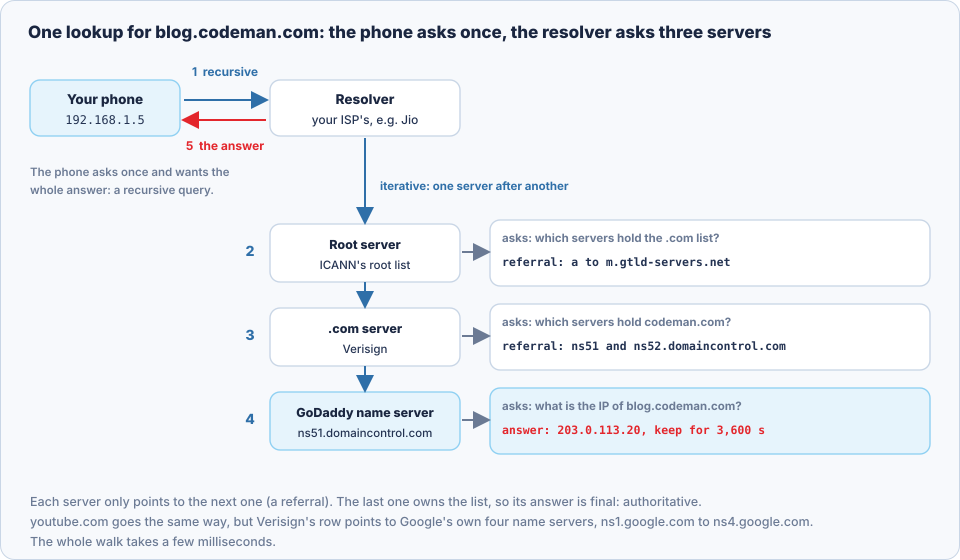

The **difference between the two kinds of query is who does the work**:

| | Recursive query | Iterative query |
|---|---|---|
| Who asks whom | the phone asks the resolver | the resolver asks root, `.com`, name server |
| What is asked | "Find the full answer and bring it back" | "Tell me what you know" |
| What comes back | the final address (or an error) | the answer, or a referral: "ask these servers instead" |
| Who walks | the resolver, for you | nobody: each server only points ahead |

**The same for `youtube.com`.** It takes the same three steps. The root names the `.com` servers. Verisign says that the list of `youtube.com` is on Google's own four name servers (`ns1.google.com` to `ns4.google.com`). A Google name server then gives the address of a YouTube server. A real trace on 15 November 2026 ended with `youtube.com. 300 IN A 142.250.x.x` (shown in part).

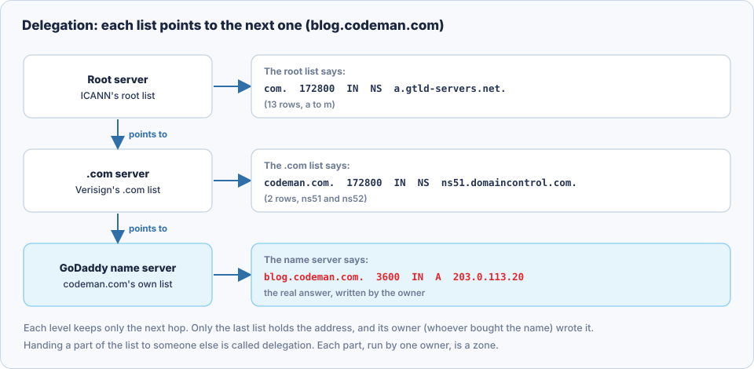

**Delegation.** Nobody holds the whole list. The root list says only who holds each TLD's list; the `.com` list says only who holds `codeman.com`'s list; the name servers hold the real answer. Handing a part of the list to someone else is **delegation**. Each part, run by one owner, is a **zone**.

> **Beyond the video: glue.** A referral says "ask `ns51.domaincontrol.com`", but to ask it you need its address, and you are still looking for addresses. To break the circle, the parent server often sends the name server's address along with the referral. It is called a **glue record**. When the name servers are inside the domain itself, glue is needed.

> **Beyond the video: only as much as needed.** The old way sends the full name `blog.codeman.com` even to the root, which only needs `com`. Modern resolvers send each server only the part it needs (**QNAME minimisation**, [RFC 9156](https://www.rfc-editor.org/rfc/rfc9156.html)), a small privacy gain. The three steps are the same either way.

> **Beyond the video: port 53.** DNS questions go to port 53. Most use UDP; TCP is used when an answer is too big for one packet ([RFC 1035](https://www.rfc-editor.org/rfc/rfc1035.html)). Ports and the difference between TCP and UDP come in Ep 4.

## 10. Records: what is in the list

The lines in a domain's list are called **records**, and each record has a **type**. A contact has a mobile number, an office number and an email; in the same way a domain has different kinds of records. Here is the list of our example domain, with a TTL column (section 11):

| Name | TTL | Type | Value |
|---|---|---|---|
| `codeman.com` | 3600 | `A` | `203.0.113.10` |
| `blog.codeman.com` | 3600 | `A` | `203.0.113.20` |
| `codeman.com` | 3600 | `AAAA` | `2001:db8::10` |
| `www.codeman.com` | 3600 | `CNAME` | `codeman.com.` |
| `codeman.com` | 3600 | `MX` | `1 smtp.google.com.` |
| `codeman.com` | 3600 | `TXT` | `"google-site-verification=…"` |
| `codeman.com` | 86400 | `NS` | `ns51.domaincontrol.com.` |

| Type | Full form | Holds | Why |
|---|---|---|---|
| **A** | Address record | an IPv4 address | the rows for `codeman.com` and `blog.codeman.com` |
| **AAAA** | "quad A" | an IPv6 address: 128 bits, four times the 32 bits of an A record ([RFC 3596](https://www.rfc-editor.org/rfc/rfc3596.html)) | the same name over IPv6 (Ep 2) |
| **CNAME** | Canonical Name | **another name**, not an address | `www.codeman.com` says "my real name is `codeman.com`: take that address". When the server changes, only one row changes |
| **MX** | Mail Exchange | the server that takes the domain's email, with a priority number (lower is tried first) | if I use Gmail for `amit@codeman.com`, the MX row names Google's mail server ([Google Workspace help](https://support.google.com/a/answer/174125)) |
| **TXT** | Text | free text | often to **prove** you own a domain: Google asks you to put a code in a TXT row, then looks for it ([Search Console help](https://support.google.com/webmasters/answer/9008080)) |
| **NS** | Name Server | the name servers of the domain | the same servers that Verisign's row names |

Two rules worth knowing:

- A name that has a CNAME cannot hold other records at the same name: the CNAME means "everything about this name is over there" ([RFC 1034 §3.6.2](https://www.rfc-editor.org/rfc/rfc1034.html)). That is why a CNAME is not allowed at the top of a domain (`codeman.com` itself), which also carries NS and MX rows. Some DNS hosts offer a workaround under names such as ALIAS or ANAME; it is not a standard record.
- A name can have **several** A records. The resolver gets all of them, which is the base of the rotation in section 12. (For example, a lookup of `www.youtube.com` on 15 November 2026 returned eight A records directly.)

> **Beyond the video: mail.** When someone emails `amit@codeman.com`, the sender's mail server asks DNS for the **MX** rows of `codeman.com` and delivers to the server named there ([RFC 5321 §5.1](https://www.rfc-editor.org/rfc/rfc5321.html)).

## 11. Cache and TTL

If every visit to `blog.codeman.com` needed these three trips, every page would open late, and the root and Verisign servers would carry the whole world's load. So answers are **remembered for a while**: this is the **cache**.

- The **resolver** caches every answer it gets.
- The **phone** and the **browser** keep small caches of their own.

How long? Every record says so itself, like the **expiry date on a milk packet**. This is its **TTL**: **Time To Live**, in **seconds**, the middle number we saw in Verisign's row. The **owner of the domain** sets it: on GoDaddy's DNS page there is a TTL column for each record. Suppose I set one hour, **3,600 seconds**, on the blog's record.

So if Jio's resolver asks GoDaddy once, then for the next hour every Jio user gets the answer from the resolver's memory.

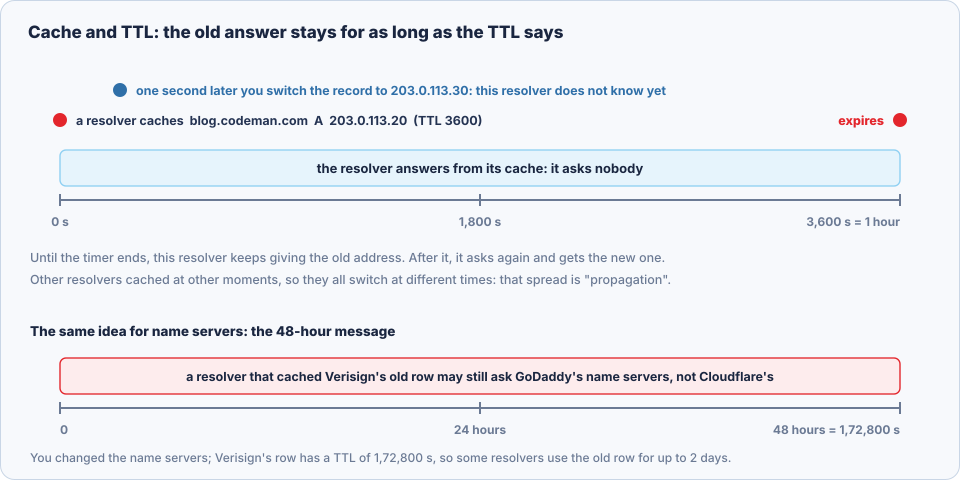

**The video's second question.** The blog's record has a TTL of 3,600. I move the blog to a new server and write the new address on GoDaddy. A resolver cached the old answer **one second ago**. For how long can it still give the old address? A: not at all · B: about an hour · C: forever.

The answer is **B: about an hour**: 60 × 60 = 3,600 seconds. Until then the resolver asks nobody, so it never sees the change.

**The 48-hour message.** If you have ever bought a domain, you have seen a notice like *"changes can take up to 48 hours"*. Where does 48 come from?

- When I change the **name servers** from GoDaddy to Cloudflare, the resolvers that cached Verisign's **old** row (`codeman.com. 172800 IN NS ns51.domaincontrol.com.`) keep it for up to **1,72,800 seconds**.
- 1,72,800 ÷ 3,600 = **48 hours**.

So some resolvers can keep going to GoDaddy's name servers for up to two days. (Many resolvers keep records for less than the maximum, so in practice changes often show up sooner. The message is a safe upper estimate. Cloudflare says up to 24 hours.)

> **"Propagation" is only caches running out.** Nothing travels across the world. Every resolver cached the record at a different moment, so they all pick up the change at different moments, each when its own timer ends.

**Choosing a TTL: a trade-off.**

| | Long TTL (a day) | Short TTL (a minute or five) |
|---|---|---|
| Lookups to your name servers | very few: the load stays low | many: the load and the cost go up |
| User speed | most answers come from a nearby cache | more users wait for a full lookup |
| Change takes effect | slowly: people reach the old server for hours, like relatives arriving at your old house after you moved | quickly |
| If your name servers go down | caches can keep serving the address for a while | caches empty soon: users feel it sooner |

As an example, `youtube.com`'s address record has a TTL of only **300 seconds** (5 minutes): YouTube wants to change answers fast. A common middle: a few minutes to an hour for a record that may change, and a long TTL for one that almost never does.

**Before a planned move: lower the TTL first.** This is the video's fourth interview question. The practice is in the standard itself: reduce the TTL before an anticipated change, and raise it again afterwards ([RFC 1034 §3.6](https://www.rfc-editor.org/rfc/rfc1034.html)).

1. Today the TTL of `codeman.com` is 86,400 (one day). Next week I must move the site to a new server.
2. **At least a day before the move**, lower the TTL to 300 (five minutes). It must be a full old TTL ahead: a cache that stored the record just before you lowered it still holds it for up to 86,400 seconds.
3. On the day, **change the address**. Every cache now holds a copy that lasts at most five minutes, so everyone has the new address in five minutes.
4. A few days later, when all is well, **raise the TTL** back, so the lookups stay few.

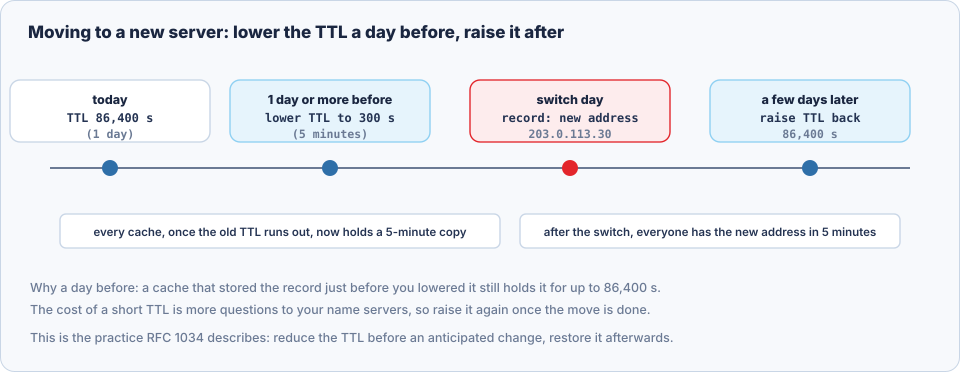

> **Beyond the video: a cache can also remember "no".** If a name does not exist, the answer "no such name" is cached too, for a time set by the zone ([RFC 2308](https://www.rfc-editor.org/rfc/rfc2308.html)). A name you query before you create it can look missing for a while after you add it.

A cache in code, to see the rule: an entry is valid until `now + ttl`.

```python
import time

class DnsCache:
    def __init__(self, clock=time.monotonic):
        self.clock = clock
        self.entries = {}                       # name -> (address, expires_at)

    def put(self, name: str, address: str, ttl: int):
        self.entries[name] = (address, self.clock() + ttl)

    def get(self, name: str):
        entry = self.entries.get(name)
        if entry is None:
            return None                         # never asked
        address, expires_at = entry
        if self.clock() >= expires_at:
            del self.entries[name]              # the TTL has run out: ask again
            return None
        return address

now = [0]
cache = DnsCache(clock=lambda: now[0])
cache.put("blog.codeman.com", "203.0.113.20", ttl=3600)
now[0] = 3599; print(cache.get("blog.codeman.com"))   # 203.0.113.20: still cached
now[0] = 3600; print(cache.get("blog.codeman.com"))   # None: ask the name server again
```

## 12. DNS for traffic: by place, in turn, and failover

YouTube's servers are not in one place: they are in many cities of the world, in India too. DNS need not give the same answer to everybody.

- **By place.** Google's name server sees which **resolver** is asking: to a Mumbai resolver it gives the address of a server near Mumbai, to a Delhi resolver one near Delhi. So the address of `youtube.com` can be different for you and for a friend in another city. (It sees the resolver, not your phone, unless the resolver passes on a part of your address; that extension is called EDNS client subnet.) Cloud DNS services offer this too, for example the [AWS Route 53 routing policies](https://docs.aws.amazon.com/Route53/latest/DeveloperGuide/routing-policy.html).
- **In turn.** Give a different server's address to every new question, one after the other, and the load is **divided**. This is **DNS load balancing** (round robin, in its simplest form, [RFC 1794](https://www.rfc-editor.org/rfc/rfc1794.html)).
- **Failover.** If a server dies, the name server **stops giving its address**. Records like this get a **short TTL**, about 60 seconds, so that the caches also update soon. (AWS's own advice for health-checked records is a TTL of 60 seconds or less.)

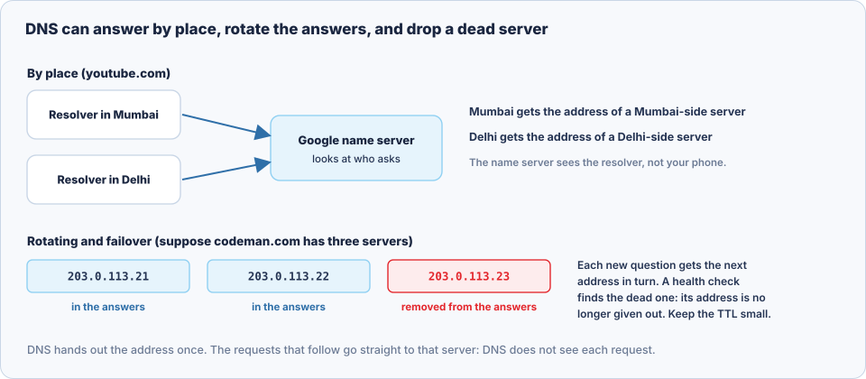

**But DNS is not a load balancer.**

| | DNS | Load balancer |
|---|---|---|
| When it works | once, when the name is looked up | on every single request |
| What it sees | the question, and the resolver that asked | each request, and how busy each server is |
| A dead server | users keep the old address until the TTL ends | removed at once, from the next request |
| Control | rough: caches decide how long answers stay | exact: it can send 10% here and 90% there |

DNS gives the address **once**, and then the requests go straight to that server. Splitting the load on **every request** is a **load balancer's** job, and it is a topic of its own later in the series. In real systems the two work together: DNS sends you to the right **city**, and a load balancer there shares the work among its servers.

## 13. When DNS is the one that fails: October 2021

**4 October 2021.** Facebook, Instagram and WhatsApp did not open for about **6 hours**.

- Their servers were **running**, but a mistaken network change cut Facebook's own DNS servers off from the internet. Meta's own report says the DNS servers were unreachable even though they were still working.
- With no name server to answer, no resolver could find an address for their names, so no packet was ever sent. The app servers behind them were fine; nobody could find them by name.
- Everyone's phones kept asking again and again, so the load on resolvers rose too.

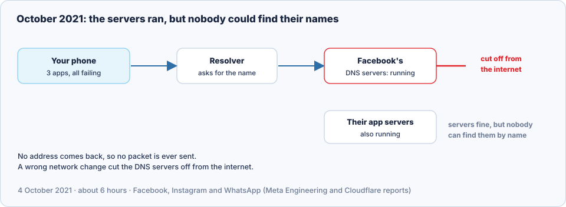

The lessons for a designer:

- DNS is a **dependency of everything**. If it breaks, nothing works, however healthy your servers are.
- Do not put every DNS server behind one network or one provider; and think about what depends on your DNS (even your own tools to repair it).
- A longer TTL can hide a short DNS failure from many users, and a very short one makes users feel it at once. Another reason the TTL is a design decision.

## 14. Interview questions

Each question says where it comes from:

- **Reported**: a candidate wrote publicly that they were asked it. It does not mean the company still asks it.
- **Tagged**: a question bank lists the problem with that company's tag. It does not say that anyone was asked it.
- **Common topic**: it appears on many interview preparation lists.
- **Our question**: written by us to test the idea.

The two questions inside the video, about three servers and the TTL of 3,600, are answered in sections 9 and 11. The first four below are the video's interview round. Try each one before you read the answer.

### From the video

**1. You type google.com in the browser and press Enter. What happens first?**

*Reported · Walmart Global Tech India · SDE 2 (fresher), on campus · LeetCode Discuss, post dated Aug 2022.* [The post](https://leetcode.com/discuss/post/2559079/walmart-global-tech-india-sde2fresher-oncampus-interview-questions)

The browser needs the **IP address** of `google.com` before it can send anything, so a **DNS lookup** comes first: the browser's own cache, then the operating system's cache, then the resolver (section 9), and if that has no answer, root, `.com` and Google's name server. Only then does it connect to that address and send the request. (The connection and the request come in later episodes.)

**2. Name the two kinds of query in a DNS lookup.**

*Reported · Amazon · AWS Cloud Support Associate, campus, 2020 · GeeksforGeeks (updated Oct 2024).* The candidate was asked about the DNS query process. [The post](https://www.geeksforgeeks.org/interview-experiences/amazon-aws-interview-experience-for-cloud-support-associate-2020/)

The phone's query to the resolver is **recursive**: it asks for the complete answer. The resolver's queries to root, `.com` and the name server are **iterative**: each server only answers or points to the next one (a referral). A follow-up you may get: *what does the resolver do on the second lookup?* It answers from its cache, until the TTL ends.

**3. Count the visits to every domain. (LeetCode 811, Subdomain Visit Count.)**

*Tagged · Google, Microsoft · LeetCode 811.* The company tags come from a public mirror of LeetCode's premium data ([the problem](https://leetcode.com/problems/subdomain-visit-count/), [the mirror](https://github.com/liquidslr/leetcode-company-wise-problems), commit 2b71796, Oct 2026). It is a tag, not a report that anyone was asked it.

`blog.codeman.com` got 100 visits. Which domains does that add to? **Three**: `blog.codeman.com`, `codeman.com` and `com`, because every level is a domain (section 3). Split the name at its dots and add the count to every suffix, from the full name down to the TLD:

```python
from collections import Counter

def subdomain_visits(cpdomains):
    count = Counter()
    for row in cpdomains:
        n, name = row.split()
        parts = name.split(".")
        for i in range(len(parts)):              # blog.codeman.com, codeman.com, com
            count[".".join(parts[i:])] += int(n)
    return [f"{v} {k}" for k, v in count.items()]

print(subdomain_visits(["100 blog.codeman.com", "50 codeman.com", "5 mail.google.com"]))
# ['100 blog.codeman.com', '150 codeman.com', '155 com', '5 mail.google.com', '5 google.com']
```

Time and space are O(total length of the names): each name is split once and has only a few levels.

**4. Your TTL is one day, and next week you move the app to a new server. What do you do before the move?**

*Our question · system design.* In the video: `codeman.com`, TTL 86,400 s (one day), moving next week.

Lower the TTL **at least one day before** the move, say to 300 seconds (five minutes), because caches that stored the record just before the change can hold it for a full day. On the day, change the address: everybody has the new one within five minutes. A few days later, raise the TTL again. (Section 11, and [RFC 1034 §3.6](https://www.rfc-editor.org/rfc/rfc1034.html).)

### More practice

**5. Why is DNS hierarchical, and not one central list?**

*Common topic · DNS.* It is asked in the form "why hierarchical instead of centralized" in the [GeeksforGeeks networking list](https://www.geeksforgeeks.org/computer-networks/networking-interview-questions/), and many other lists explain the hierarchy.

One list means one place that every change must reach, one server that every question must reach, and one point of failure. HOSTS.TXT showed it (section 2). With a tree, each owner changes only their own zone, the questions are spread over millions of servers, and caches take most of the rest.

**6. Which port does DNS use, and which transport?**

*Common topic · DNS.* The port appears on four of the public interview lists we checked, including [PlacementPreparation](https://www.placementpreparation.io/blog/networking-interview-questions-for-freshers/) and the [GeeksforGeeks list](https://www.geeksforgeeks.org/computer-networks/networking-interview-questions/).

Port **53**. Most queries use **UDP**, since a question and an answer fit in one packet each; **TCP** is used when the answer is too big. (TCP and UDP are the topic of Ep 4.)

**7. Is DNS a load balancer? When would you use each?**

*Our question · system design.*

No. DNS answers once per lookup and then caching hides everything else. Use DNS to send users to the right region (by place) and to take a whole region out; use a load balancer to share every request among servers and to react to a server's death in seconds. (Section 12.)

**8. A site is down, but its servers are healthy and nothing was deployed. What can you check?**

*Our question · system design.*

Whether its **name** still resolves. Run `dig` for its A record: no answer, or `SERVFAIL`, points at DNS (name servers unreachable, an expired domain, a broken record), not at the servers. Try the address directly: if that works, DNS is the problem. This was the shape of the October 2021 outage (section 13).

**9. You updated a record, but some users still see the old address. Why, and what do you do?**

*Our question · system design.*

Their resolver or browser holds the old answer until the **TTL** runs out (section 11). Wait up to the old TTL; you cannot flush other people's caches. For next time, lower the TTL before the change. To check what a given resolver says, ask it directly with `dig @resolver name`.

**10. What is the difference between a registrar, a registry and a name server?**

*Our question · system design.*

The **registrar** (GoDaddy) sells you the domain and keeps your customer record. The **registry** (Verisign for `.com`) keeps the TLD's list: for your domain only the names of your name servers. The **name server** keeps your own records, the ones that hold the IP addresses. You can change the name servers without changing the registrar. (Sections 5 to 7.)

## 15. Try it yourself

1. **Follow the lookup from the root, step by step.**

```bash
dig +trace youtube.com
```

   It starts at the root hints and prints each referral, in the order of section 9. It has this shape (your values will differ):

```text
.                    600     IN  NS   a.root-servers.net.         <- the root servers, from the root hints
...
com.                 172800  IN  NS   a.gtld-servers.net.         <- the root's referral to the .com servers
...
youtube.com.         172800  IN  NS   ns1.google.com.             <- .com's referral to Google's name servers
...
youtube.com.         300     IN  A    142.250.x.x                 <- the authoritative answer (shown in part)
```

   Look at the three groups: root, `.com`, and the authoritative answer. Note the TTLs: 172800 on the referrals, 300 on the answer.

2. **Ask for one record type.**

```bash
dig youtube.com A
dig youtube.com NS
dig google.com MX
dig google.com TXT
```

   In the `ANSWER SECTION` the second column is the **TTL**. Run the same `dig` twice, a few seconds apart: through a caching resolver, the TTL counts **down**, because you are seeing the cache's copy.

3. **Be the resolver: ask the servers yourself, one by one, without recursion.**

```bash
dig +norecurse @a.root-servers.net youtube.com A
dig +norecurse @a.gtld-servers.net youtube.com NS
```

   The first one has an empty answer section, and the authority section lists the `.com` servers: a referral. The second one shows the row of section 6, `youtube.com. 172800 IN NS ns1.google.com.`, and in the additional section the addresses of Google's name servers (the glue). Neither server knows the final address.

4. **Which resolver am I using?** On a Mac: `scutil --dns | grep nameserver`. On Linux: `resolvectl status` or `cat /etc/resolv.conf`. On Windows: `ipconfig /all` (the "DNS Servers" line). On a phone, the WiFi details page shows the DNS entry that DHCP gave.

5. **`nslookup`, the same question in a simpler tool** (also on Windows):

```bash
nslookup youtube.com
nslookup -type=MX google.com
nslookup youtube.com 1.1.1.1
```

   The last one asks the resolver `1.1.1.1` instead of your own. Two resolvers can give different addresses for the same name, which is DNS answering by place.

6. **See the answer in Python.**

```python
import socket
print(socket.getaddrinfo("youtube.com", 443, proto=socket.IPPROTO_TCP)[0][4])   # the first address your system resolved
```

7. **The hosts file wins.** Add the line `203.0.113.10  blog.codeman.com` to `/etc/hosts` (it needs `sudo`), then run `ping -c 1 blog.codeman.com`: it goes to that address without asking DNS. Remove the line afterwards.

## 16. One-page revision

- Packets carry addresses, not names. DNS = Domain Name System: name → IP address.
- Old way: one file, HOSTS.TXT, kept by the NIC at SRI (Menlo Park, California), changes by email, copied by every computer. It broke as computers grew to thousands. 1983: Paul Mockapetris, many small lists (DNS). 1985: first `.com`, symbolics.com. From 1999: many registrars.
- Read a name right to left: root (hidden dot) → TLD (`.com`, 1,436 today) → domain (`codeman.com`) → subdomain (`blog`). Every level is a domain.
- **ICANN** (non-profit, 1998) keeps the **root list** of TLDs. New TLD: apply to ICANN (2012: about 1,930 applications, USD 1,85,000; 2026: USD 2,27,000). Each TLD has a **registry**: Verisign for `.com` (about 17 crore names), NIXI for `.in`.
- **Registrar** = where you buy (GoDaddy, Hostinger). **Registry** = the TLD's list (Verisign). **Name server** = your own list. Of the price, about USD 11 goes to Verisign and 20 cents to ICANN.
- The registry row: `codeman.com. 172800 IN NS ns51.domaincontrol.com.` = name · TTL in seconds (1,72,800 = 2 days) · class IN · type NS · name server. No IP address there. Two name servers, same list, for backup.
- A subdomain costs nothing: one more row in your list. Changing name servers at the registrar moves your list (for example to Cloudflare); the domain stays at the registrar.
- `.com` has 13 servers (a to m.gtld-servers.net), all Verisign's, same copy. The root has 13 names (A to M), 12 operators, 2,046 copies. The letters are just names. 13 because an answer had to fit in 512 bytes. **Anycast**: the nearest copy answers.
- Resolver (usually the ISP's, or 8.8.8.8 / 1.1.1.1) walks for the phone. Phone → resolver: **recursive** (full answer). Resolver → servers: **iterative** (an answer or a **referral**). It knows the root from the **root hints**.
- First lookup, empty cache: **three trips**: root → `.com` (Verisign) → the name server (**authoritative**, owns the list).
- Records: **A** (IPv4), **AAAA** (IPv6), **CNAME** (another name), **MX** (mail, `smtp.google.com` for Gmail), **TXT** (text, proof), **NS** (name servers). Row: name · TTL · type · value.
- **Cache** at resolver, OS, browser. **TTL** = seconds a copy may be used: 3,600 = 1 hour. The old address lives up to the TTL.
- "48 hours": the registry's NS row has TTL 1,72,800 s = 48 h. "Propagation" = caches expiring. `youtube.com`'s A record: 300 s.
- Long TTL: few lookups, slow change. Short TTL: fast change, more lookups. Before a move: lower the TTL **a day or more ahead**, switch, raise it again.
- DNS can answer by place, rotate addresses and drop a dead server (TTL about 60 s). It gives the address once: **not a load balancer**.
- DNS down = everything down (4 October 2021, about 6 hours). Port 53, mostly UDP.
- Commands: `dig +trace youtube.com`, `dig youtube.com A`, `nslookup youtube.com`.
- Next: Ep 4. A packet has the address now; what if packets are lost or arrive out of order?

## Sources

- DNS design and names: [RFC 1034](https://www.rfc-editor.org/rfc/rfc1034.html) and [RFC 1035](https://www.rfc-editor.org/rfc/rfc1035.html) · 1983 tree design: [RFC 882](https://www.rfc-editor.org/rfc/rfc882.html), [RFC 883](https://www.rfc-editor.org/rfc/rfc883.html) · TTL rules: [RFC 2181](https://www.rfc-editor.org/rfc/rfc2181.html) · Negative caching: [RFC 2308](https://www.rfc-editor.org/rfc/rfc2308.html) · Terms (resolver, referral, root hints, anycast): [RFC 9499](https://www.rfc-editor.org/rfc/rfc9499.html) · QNAME minimisation: [RFC 9156](https://www.rfc-editor.org/rfc/rfc9156.html)
- The HOSTS.TXT era: [RFC 952](https://www.rfc-editor.org/rfc/rfc952.html) (the host table, the NIC, HOSTMASTER@SRI-NIC.ARPA) · [RFC 1034 §2.1](https://www.rfc-editor.org/rfc/rfc1034.html) (why it broke) · weekly rebuild and email requests, from histories: [Rework, history of DNS](https://resources.rework.com/libraries/history-of-internet/history-of-dns), [Bortzmeyer, history of TLDs](https://www.bortzmeyer.org/files/HistoryoftheTLDs.html) · the first `.com` in 1985 and Network Solutions: widely documented, not rechecked against a primary source for these notes
- ICANN and the root: [ICANN, about](https://www.icann.org/en/about) (non-profit, 1998) · [IANA, about](https://www.iana.org/about) · [IANA root zone database, `.in`](https://www.iana.org/domains/root/db/in.html) (NIXI) · [ICANN–Verisign Root Zone Maintainer Agreement](https://icann.org/iana_imp_docs/63-root-zone-maintainer-agreement-v-1-0) · new TLD rounds: [ICANN new gTLD program](https://newgtlds.icann.org), [ICANN, 2026 round closes](https://www.icann.org/en/announcements/details/icann-2026-round-closes-with-more-than-1600-new-gtld-applications-13-08-2026-en); the fees (USD 1,85,000 and USD 2,27,000) and the 2012 count come from secondary reports. `.google` and `.youtube` as Google's TLDs: live `dig NS google.` and `dig NS youtube.`, 15 November 2026
- Registry and registrar: [EPP, RFC 5730](https://www.rfc-editor.org/rfc/rfc5730.html) · wholesale `.com` price (USD 10.97 from 1 November 2026) and the ICANN fee of about 20 cents: [Domain Name Wire](https://domainnamewire.com/2026/04/23/breaking-verisign-raising-wholesale-com-prices/) (secondary) · GoDaddy's name servers of the form `nsNN.domaincontrol.com`: registrar guides and [GoDaddy Help](https://www.godaddy.com/help/change-nameservers-664) (the numbers 51 and 52 are only an example) · [Cloudflare, change your name servers](https://developers.cloudflare.com/dns/zone-setups/full-setup/setup/)
- TLD count: [IANA TLD list](https://data.iana.org/TLD/tlds-alpha-by-domain.txt) (version 2026111500, 1,436 TLDs) · Registered names and `.com` count: [DNIB, Q3 2026](https://circleid.com/posts/dnib-reports-411.6-million-domain-name-registrations-in-q3-2026) (411.6 million; `.com` 169.8 million)
- Root servers: [named.root](https://www.internic.net/domain/named.root) · [root-servers.org](https://root-servers.org) (2,046 copies on 15 November 2026; the count for India, 65 copies in 26 cities, was read on 14 November, so the notes say "more than 60") · [IANA, root servers](https://www.iana.org/domains/root/servers) · [ICANN RSSAC FAQ](https://www.icann.org/resources/pages/rssac-faq-2018-03-05-en) (the 512-byte reason) · the `.com` servers: live `dig +norec @a.root-servers.net com NS`, 15 November 2026
- Live checks, 15 November 2026: `dig +trace youtube.com`; `dig +norec @a.gtld-servers.net youtube.com NS` (`youtube.com. 172800 IN NS ns1.google.com.` to `ns4`); the A record of `youtube.com` with a TTL of 300 seconds
- Packets and addresses: [RFC 791](https://www.rfc-editor.org/rfc/rfc791.html) · AAAA records: [RFC 3596](https://www.rfc-editor.org/rfc/rfc3596.html) · Mail and MX: [RFC 5321](https://www.rfc-editor.org/rfc/rfc5321.html), [Google Workspace MX records](https://support.google.com/a/answer/174125) · DHCP's DNS server option: [RFC 2132](https://www.rfc-editor.org/rfc/rfc2132.html) · Documentation addresses: [RFC 5737](https://www.rfc-editor.org/rfc/rfc5737.html), [RFC 3849](https://www.rfc-editor.org/rfc/rfc3849.html)
- Resolvers: [Cloudflare 1.1.1.1 docs](https://developers.cloudflare.com/1.1.1.1/) · [Google Public DNS](https://developers.google.com/speed/public-dns) · Caches on the phone and the browser: [Android DNS resolver](https://source.android.com/docs/core/ota/modular-system/dns-resolver)
- The 48-hour notice: [GoDaddy Help](https://www.godaddy.com/help/what-factors-affect-dns-propagation-time-1746) · Verification records: [Google Search Console help](https://support.google.com/webmasters/answer/9008080)
- DNS traffic: [AWS Route 53 routing policies](https://docs.aws.amazon.com/Route53/latest/DeveloperGuide/routing-policy.html) · [Route 53 failover records](https://docs.aws.amazon.com/Route53/latest/DeveloperGuide/resource-record-sets-values-failover.html) · [RFC 1794](https://www.rfc-editor.org/rfc/rfc1794.html)
- The 2021 outage: [Meta Engineering, 5 October 2021](https://engineering.fb.com/2021/10/05/networking-traffic/outage-details/) · [Cloudflare, 4 October 2021](https://blog.cloudflare.com/october-2021-facebook-outage/)
- Interview write-ups: [Walmart Global Tech India, LeetCode Discuss](https://leetcode.com/discuss/post/2559079/walmart-global-tech-india-sde2fresher-oncampus-interview-questions) · [Amazon AWS Cloud Support Associate, GeeksforGeeks](https://www.geeksforgeeks.org/interview-experiences/amazon-aws-interview-experience-for-cloud-support-associate-2020/) · [LeetCode 811](https://leetcode.com/problems/subdomain-visit-count/) with the [company tag mirror](https://github.com/liquidslr/leetcode-company-wise-problems) · Interview lists: [GeeksforGeeks](https://www.geeksforgeeks.org/computer-networks/networking-interview-questions/) · [PlacementPreparation](https://www.placementpreparation.io/blog/networking-interview-questions-for-freshers/)
