# Episode 4: TCP vs UDP

**System Design (Hindi) · Code Man**

These are the notes for Episode 4. The video explains everything step by step in Hindi; these notes follow the same path in simple English, go a little deeper, and are made to be revised quickly before an interview. Boxes marked **Beyond the video** are extra material the video had no time for.

- Video: [What Exactly Happens When You Text Your Girlfriend? (TCP vs UDP)](https://youtu.be/dI7rIUbGgcw) (public from Sat 21 Nov, 8:00 PM IST)
- PDF of these notes: [ep04-tcp-udp.pdf](ep04-tcp-udp.pdf)
- Previous episode: [Ep 3: DNS (Domain Name System)](../ep03-dns/README.md) · Next: Ep 5

The running example is a real one: an Instagram message (a DM) sent from your phone `192.168.1.5` on your home WiFi to Instagram's server `i.instagram.com`. Its real address is not shown here; we write it as `57.144.x.x`. The port numbers 51000, 52000 and 53000, and the starting numbers 1000 and 5000, are our own picks to keep the counting easy; real ones are different, and the notes say so where it matters.

## In one minute

- An Instagram DM always arrives whole and in order. An Instagram video call skips and breaks up, and carries on. Same phone, same app, opposite behaviour. The reason is two different **protocols** (sets of rules that the sender and the receiver both follow): **TCP** (Transmission Control Protocol) for the DM, **UDP** (User Datagram Protocol) for the call.
- A **port** is a 16-bit number (0 to 65,535, so 65,536 ports for TCP and another 65,536 for UDP). The IP address is the station, the port is the platform: the address finds the device, the port finds the app inside it. Servers use fixed ports from IANA's public list (443 for HTTPS, 80 for HTTP, 53 for DNS, 22 for SSH, 25 for email servers, 5432 for PostgreSQL, 3306 for MySQL). The phone gets a free port for each new connection (say 51000). The **four numbers** (two addresses, two ports) make one connection.
- **TCP three-way handshake**, on the real example: the phone sends `SYN` with `SEQ 1000` (no message inside); the server answers `SYN ACK`, `SEQ 5000`, `ACK 1001`; the phone sends `ACK 5001`. It costs one round trip, so Instagram keeps one long-lived connection open.
- TCP numbers every **byte**. The 30-byte DM "Kal 5 baje CP pe milte hain :)" is cut into segments, each with the number of its first byte. The server's **ACK** is always the next byte it needs: 1011, 1021, 1031. If a segment is lost, the same ACK comes again; after three extra copies the phone resends at once. The price is **head-of-line blocking**: segments behind the lost one wait.
- Speed: the **window** (how much room the server has) is **flow control**; **congestion control** starts with about 10 segments, doubles while all is well and cuts the speed on a loss. That is why downloads start slow. **FIN** closes the connection.
- **UDP** has no handshake, no sequence numbers, no ACKs and no resend. Its header is **8 bytes** (TCP's is at least 20). A call sends sound in **20 ms** packets, 50 a second; a lost one is skipped and the gap is filled from the sound around it.
- **Rule:** where every byte must arrive (websites, app APIs, chat, UPI payments, downloads), TCP. Where being on time matters more than being complete (calls, games), UDP. DNS uses UDP on port 53 and TCP on port 53 when an answer is cut short.
- **QUIC** (made by Google) rebuilds order, resend and encryption on top of UDP, with separate **streams**. YouTube and much of Instagram's traffic use it, and **HTTP/3** runs on it.

## 0. Where Ep 3 left off

Ep 1 to Ep 3 followed one message from your phone to a server. Every packet carries the sender's and the receiver's **address** ([Ep 1](../ep01-ip-address/README.md)) and, as we saw in [Ep 2](../ep02-subnet-mask-nat/README.md), a **port** too. Ep 3 ended with a problem: on the way, packets can be **lost** and can arrive **out of order**. IP's own description says it has no mechanism for reliability, flow control or sequencing ([RFC 791 §1.2](https://www.rfc-editor.org/rfc/rfc791.html)).

Now look at Instagram on your phone. A DM you send always arrives whole, never half, never in the wrong order. But in an Instagram video call the voice breaks up now and then, and the call keeps going. Who makes the message arrive whole and in order? And why does the call not ask for the lost sound again?

## 1. Two ways to send data

The answer is two different **protocols**: sets of rules that the sender and the receiver both follow. A protocol says how the data is written down, how it is sent, and what to do when something goes wrong.

- **TCP**, **Transmission Control Protocol**: every byte arrives, in order. Its specification calls it "a reliable, in-order, byte-stream service" ([RFC 9293 §2.2](https://www.rfc-editor.org/rfc/rfc9293.html)). The Instagram DM travels this way.
- **UDP**, **User Datagram Protocol**: send it and move on. Delivery "is not guaranteed" ([RFC 768](https://www.rfc-editor.org/rfc/rfc768.html)). The voice of the call travels this way.

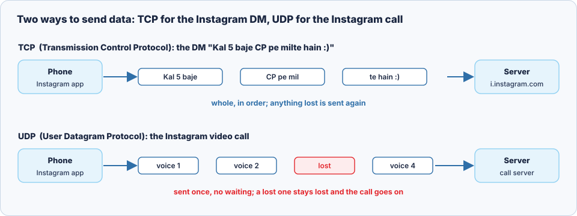

Both sit on top of IP. IP gets a packet to the right device; TCP or UDP decides what happens on top of that. Neither is "better": they answer different needs. The rest of the episode builds both from scratch, on the real DM.

## 2. Ports: which app inside the device?

Your phone has Instagram open, YouTube playing and WhatsApp running. A packet arrives at the phone's IP address. Which app is it for? The IP address cannot tell: it brings the packet to the phone, and that is all. Inside the phone, a second number does the work: the **port number**. We met it in Ep 2, where the NAT table used it.

Think of a railway station. There is one station, but many platforms, and each train arrives at its own platform number.

- The **IP address** is the **station**: it brings the packet to the right device.
- The **port** is the **platform number**: it brings it to the right app inside that device.

A port is a **16-bit number**. A bit is a 0 or a 1, and 16 bits give 2¹⁶ = 65,536 different values, so ports go from 0 to 65,535 ([RFC 9293 §3.1](https://www.rfc-editor.org/rfc/rfc9293.html), [RFC 768](https://www.rfc-editor.org/rfc/rfc768.html)). Every device has these 65,536 ports for TCP, and a separate set of 65,536 for UDP: TCP port 53 and UDP port 53 are two different ports. Every TCP and UDP packet carries two ports: a **source port** (the sender's app) and a **destination port** (the app it must reach).

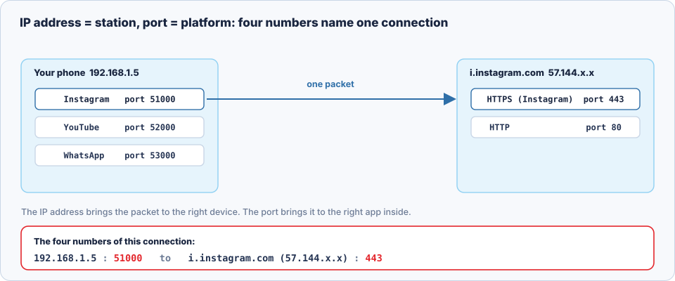

### The server's side: fixed ports

Your phone wants to talk to Instagram's server, so it must know which port the server is listening on, without asking. That is why servers use **fixed ports**, kept in a public list by **IANA**, the Internet Assigned Numbers Authority: the same organisation that hands out IP addresses ([RFC 6335 §6](https://www.rfc-editor.org/rfc/rfc6335.html), [IANA registry](https://www.iana.org/assignments/service-names-port-numbers/)).

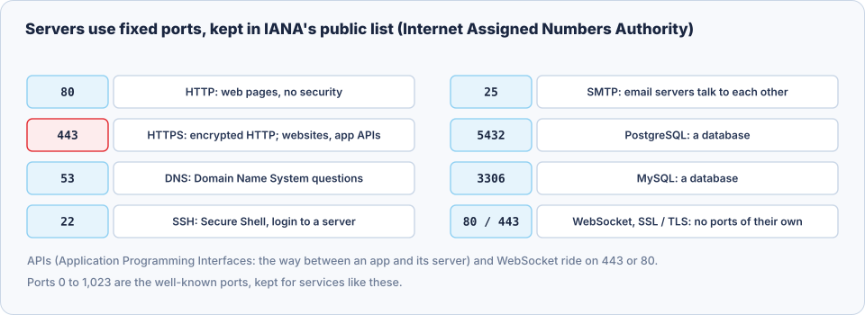

| Port | Service | What it is |
|---|---|---|
| 80 | HTTP (HyperText Transfer Protocol) | the basic way to send web pages and data, with no security |
| 443 | HTTPS (HTTP Secure) | the same HTTP, but **encrypted** (scrambled), so nobody in the middle can read it |
| 53 | DNS (Domain Name System) | the "what is the IP of this name?" questions from Ep 3 |
| 22 | SSH (Secure Shell) | how developers log in to their servers |
| 25 | SMTP (Simple Mail Transfer Protocol) | email servers sending email to each other |
| 5432 | PostgreSQL | a database |
| 3306 | MySQL | another database |

Almost every website and almost every app's **API** (Application Programming Interface, the road between an app and its server) uses HTTPS on **443**. Instagram too. If you build a backend you will see 5432 and 3306 every day.

**WebSocket and SSL/TLS have no ports of their own.** A **WebSocket** is the way live chat and live scores keep a line open to the server. It starts as an ordinary HTTP request, so it uses port 80 or 443 ([RFC 6455 §1.7](https://www.rfc-editor.org/rfc/rfc6455.html)). **SSL** (Secure Sockets Layer) is the old name of **TLS** (Transport Layer Security), the security part that turns HTTP into HTTPS. It also runs on 443 ([RFC 2818](https://www.rfc-editor.org/rfc/rfc2818.html), [RFC 8446](https://www.rfc-editor.org/rfc/rfc8446.html)). Ep 5 looks at it closely.

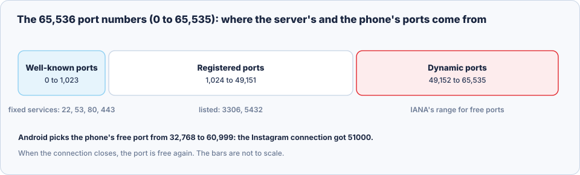

The numbers 0 to 1,023 are the **well-known ports**, kept for services like the ones above. IANA calls them system ports; 1,024 to 49,151 are registered ports (like 3306 and 5432), and 49,152 to 65,535 are dynamic ports ([RFC 6335 §6](https://www.rfc-editor.org/rfc/rfc6335.html)).

### The phone's side: a free port for each connection

The Instagram app has no fixed port on your phone. Each time it opens a new connection, the phone's **operating system** (Android, iOS) picks a **free port** by itself. On Android (which is Linux) the default range is 32,768 to 60,999, so it may pick, say, **51000** ([Linux `ip_local_port_range`](https://www.kernel.org/doc/html/latest/networking/ip-sysctl.html)). When the connection closes, 51000 is free again and another connection can get it. (A number picked like this is called an **ephemeral port**, [RFC 6056](https://www.rfc-editor.org/rfc/rfc6056.html).)

So every packet has **four numbers**: the phone's address and port (`192.168.1.5 : 51000`) and the server's address and port (`57.144.x.x : 443`). Together they are one **connection**: that is how the phone and the server both know which connection a packet belongs to. The specification calls the pair "address plus port" a **socket**, and a connection is a pair of sockets ([RFC 9293 §3.2](https://www.rfc-editor.org/rfc/rfc9293.html)).

> **Beyond the video: the ranges are only a convention.** Windows picks the phone-side port from IANA's dynamic range (49,152 to 65,535); Linux and Android use 32,768 to 60,999. What matters is only that the number is free at that moment. On Linux only a privileged program may listen on a port below 1,024.

## 3. TCP: the three-way handshake

Now the DM. You write "Kal 5 baje CP pe milte hain :)" and press send. (Today Instagram also sends a good part of its traffic with a newer method called QUIC, at the end of this episode. First the classic road: TCP.)

Before TCP sends your message, it checks that the server on the other side is really ready. It is like a phone call:

1. "Hello, can you hear me?"
2. "Yes, I can. Can you hear me?"
3. "Yes."

Three short messages, and then the real talk begins. TCP does the same with three packets, and it is called the **three-way handshake**.

**The segment and its header.** A TCP packet is called a **segment**. It starts with a **header**, the information written on top, followed by the **data** ([RFC 9293 §3.1](https://www.rfc-editor.org/rfc/rfc9293.html)). Besides the ports, the header holds **flags**. A flag is a single bit, on or off, like a tick box on a form. Two matter now:

- **SYN**, from *synchronize*: "here is my starting number".
- **ACK**, from *acknowledgement*: "I got it". Think of telling the delivery person your OTP (One-Time Password): the seller learns at once that it arrived.

And each side picks a starting number for its counting, the **initial sequence number** (ISN), written `SEQ` (sequence number).

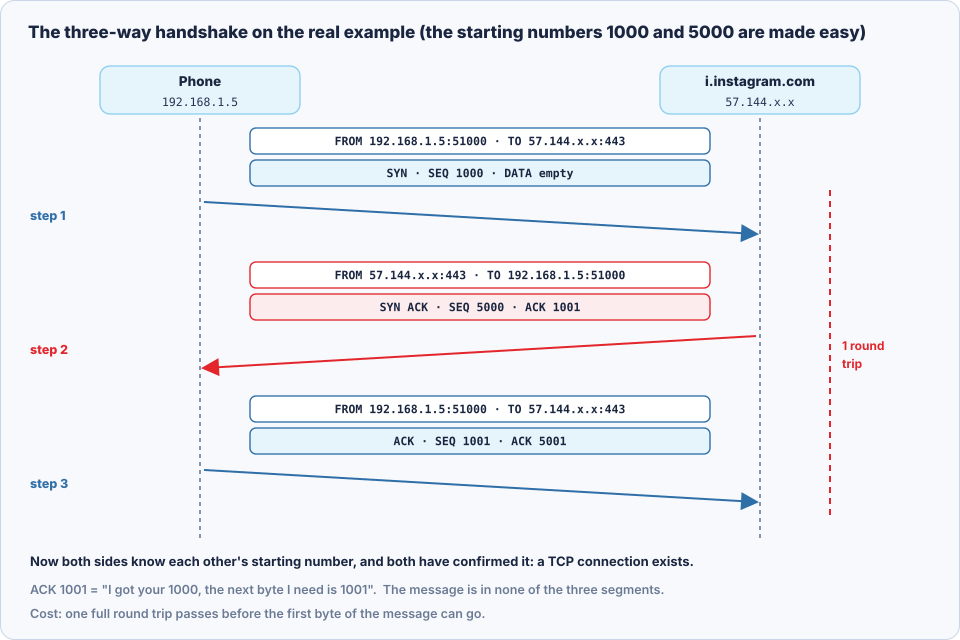

**Step 1: the phone sends the first segment.** What exactly is in it?

| Field | Value | Meaning |
|---|---|---|
| FROM | `192.168.1.5 : 51000` | the phone's address and port |
| TO | `57.144.x.x : 443` | Instagram's server and its HTTPS port |
| Flags | `SYN` on | "I want to connect" |
| SEQ | `1000` | "my counting starts at 1000" |
| Data | empty | your message is **not** in this segment |

The phone picks the starting number at random, and a real one is usually a huge number such as 2,847,193,604 (a 32-bit number, [RFC 9293 §3.4.1](https://www.rfc-editor.org/rfc/rfc9293.html); random: [RFC 6528](https://www.rfc-editor.org/rfc/rfc6528.html)). We use 1000 so the counting is easy to follow. The segment says only: "I want to connect, and my counting starts at 1000."

**Step 2: the server answers.** `SYN` on, its own starting number `SEQ 5000` (our easy number again), and the `ACK` flag on too, with **ACK number 1001**. That means: "I got everything of yours up to 1000, and the next number I need is 1001." In TCP the **ACK number is always the next number wanted**.

**Step 3: the phone confirms.** `ACK` on, ACK number **5001**: "I got your 5000; I need 5001 next." Its own `SEQ` is now 1001.

After step 3 both sides know the other's starting number, and both have confirmed it. This is a **TCP connection**, and its identity is the four numbers from section 2.

**Why exactly three steps?** Each side must send its starting number, and each number must be confirmed: four jobs. The server sends its own SYN and its confirmation of the phone's SYN in **one** segment (step 2), so four becomes three.

**The cost.** Before the first byte of your message can leave, one full **round trip** (phone to server and back) has passed in the handshake. On a 50 ms path that is 50 ms spent before anything useful moves. That is why Instagram does **not** open a new connection for every message: when the app starts it opens one connection, keeps it open, and all your messages travel on it (HTTP calls this keep-alive, [RFC 9112 §9](https://www.rfc-editor.org/rfc/rfc9112.html)).

> **Beyond the video: the real reason for three.** RFC 9293 §3.5 gives "the principal reason" for the handshake as protection against **old duplicate SYN segments**: if a delayed SYN from a connection that already ended turns up, the receiver's reply asks the sender for confirmation, and the sender, who knows it never asked, says no (a reset). With only two steps the server could not tell a real request from an old duplicate. Random starting numbers matter for security too: an attacker who could guess them could forge segments. Servers under a **SYN flood** (many SYNs, no final ACK) defend themselves with **SYN cookies** ([RFC 4987](https://www.rfc-editor.org/rfc/rfc4987.html)). For comparison, the RFC's own example uses 100 and 300.

## 4. TCP: the message in segments

Now the real message runs: **"Kal 5 baje CP pe milte hain :)"**.

**How big is it?** In a computer every English letter, every space and every digit is one **byte**, and a byte is eight bits (UTF-8, [RFC 3629](https://www.rfc-editor.org/rfc/rfc3629.html)). Count the characters, spaces and the smiley included: the message is **30 bytes**. (In reality these bytes are encrypted by HTTPS, as in port 443; that is Ep 5. To see the idea we look at them as plain text.)

**Why segments?** TCP cuts big data into pieces, and each piece goes in one segment. A real segment carries up to about **1,400 to 1,460 bytes** (the MSS, maximum segment size: the 1,500-byte limit of Ethernet minus 40 bytes of IP and TCP headers, [RFC 9293 §3.7.1](https://www.rfc-editor.org/rfc/rfc9293.html)). So this tiny message would go in one segment, while a photo or a video becomes thousands. To see the counting clearly, let us suppose a segment can hold only **10 bytes**. Then 30 bytes make three segments.

**The numbering.** Remember that the phone's counting started at 1000. So the first byte of the message, `K`, is **byte number 1001**. TCP numbers every byte, and a segment's `SEQ` is the number of its **first** byte ([RFC 9293 §3.4](https://www.rfc-editor.org/rfc/rfc9293.html)).

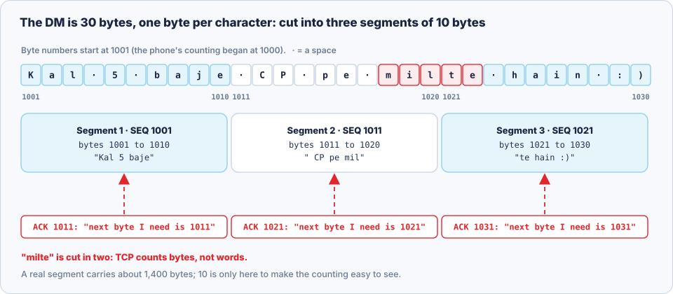

| Segment | `SEQ` | Bytes | Carries |
|---|---|---|---|
| 1 | 1001 | 1001 to 1010 | `Kal 5 baje` |
| 2 | 1011 | 1011 to 1020 | ` CP pe mil` |
| 3 | 1021 | 1021 to 1030 | `te hain :)` |

See that the word "milte" is cut into two segments, "mil" and "te". TCP does not care about words. It only counts bytes.

**ACK = the next byte I need.** After every segment the server sends an ACK. Segment 1 arrived, so the ACK is **1011**: "everything up to 1010 is here, now I need 1011". Segment 2 arrived: ACK **1021**. Segment 3: ACK **1031** ([RFC 9293 §3.4](https://www.rfc-editor.org/rfc/rfc9293.html)). An ACK is **cumulative**: ACK X means "all bytes before X have arrived". The server does not list what it has; it says where the unbroken part ends.

**Out of order is fine.** If the segments reach the server in a different order, it still puts every segment in its right place using the sequence numbers. The Instagram app gets the whole message, in order.

## 5. A lost segment, and the resend

Now the case this whole design exists for: a segment is lost on the way.

Segment 2, ` CP pe mil`, is lost, and segment 3, `te hain :)`, arrives. **Which ACK does the server send?** Not 1031 and not 1021: it is **1011**. An ACK means "everything before this has arrived". Bytes 1011 to 1020 are missing, so the server keeps saying "I need 1011". The same ACK sent again is called a **duplicate ACK**. The server does **not** throw segment 3 away: it keeps it on the side ([RFC 9293 §3.10.7.4](https://www.rfc-editor.org/rfc/rfc9293.html)). A receiver should send the duplicate at once when a segment comes out of order ([RFC 5681 §3.2](https://www.rfc-editor.org/rfc/rfc5681.html)).

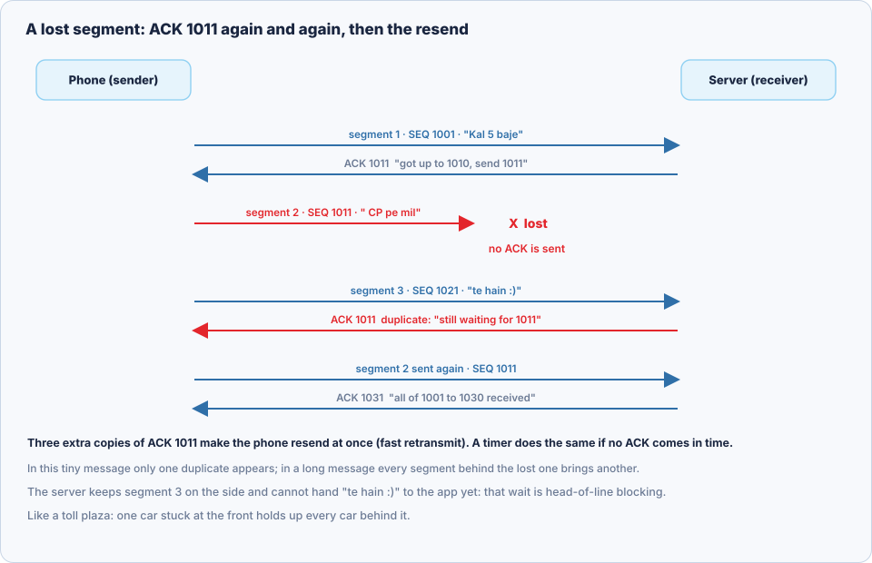

**How does the phone find out that something is lost?** Two ways:

- **A timer.** When the phone sends a segment it starts a timer. If the time runs out and no ACK has come, the phone sends the segment again. This is the **retransmission timeout** (RTO), 1 second at the start, before any measurement ([RFC 6298](https://www.rfc-editor.org/rfc/rfc6298.html)).
- **Duplicate ACKs, which is faster.** The phone keeps receiving the same ACK, 1011. When three extra copies have come, the phone understands that the segment starting at 1011 was lost, and sends it again **without waiting for the timer**. This is **fast retransmit** ([RFC 5681 §3.2](https://www.rfc-editor.org/rfc/rfc5681.html)). (In our three-segment message only one duplicate shows up. In a long message every segment behind the lost one brings another.)

Segment 2 arrives again. Now the server has 1001 to 1030 with nothing missing, and it sends **ACK 1031** straight away. Your friend's Instagram shows the whole message, in order: "Kal 5 baje CP pe milte hain :)".

**That is TCP's promise: everything arrives, in order.** It has a price. Segment 3 had already arrived, but it waited until segment 2 came back. Think of a toll plaza: if the car at the front cannot pass because its FASTag does not work, every car behind it must wait, even those with working FASTags. This is **head-of-line blocking**: the one stuck at the front of the line holds up everyone behind. HTTP's specification says it directly: a lost or reordered packet "causes all active transactions to experience a stall" on TCP ([RFC 9114 §1.1](https://www.rfc-editor.org/rfc/rfc9114.html)).

> **Beyond the video: selective ACK.** The plain ACK can only say where the unbroken part ends. Most real connections also turn on **SACK** (selective acknowledgement), which lets the server tell the sender exactly which later pieces it already holds, so only the missing one is resent ([RFC 2018](https://www.rfc-editor.org/rfc/rfc2018.html)). The idea stays the same.

## 6. TCP's speed: window and congestion

One more question: how many segments should the phone send at once? If it sent one and waited for the ACK every time, a big photo would take forever. So TCP sends many segments without waiting for ACKs. Two things decide how many.

**The receiver's room: the window.** With every ACK the server tells the phone how many bytes of free space it has right now. That is the **window** ([RFC 9293 §3.8.6](https://www.rfc-editor.org/rfc/rfc9293.html)). The phone never sends more than that, so the server does not overflow. This is **flow control**. The window field is 16 bits, so at most 65,535 bytes, unless both sides agree on a **window scale** option ([RFC 7323](https://www.rfc-editor.org/rfc/rfc7323.html)).

**The road's condition: congestion control.** The routers in between also have traffic, like a jam on a road. So TCP starts carefully, with about **10 segments** (today's systems, [RFC 6928](https://www.rfc-editor.org/rfc/rfc6928.html)). If all the ACKs come back, the next time it sends double: 20, then 40, then 80. This doubling is **slow start** ([RFC 5681 §3.1](https://www.rfc-editor.org/rfc/rfc5681.html)). As soon as a segment is lost, TCP takes it as a sign of a jam and **cuts its speed**, then grows again slowly. (How much it cuts depends on the version: classic TCP halves it; CUBIC, the Linux default, cuts it to 70 %, [RFC 9438](https://www.rfc-editor.org/rfc/rfc9438.html). So we only say "cuts".) This is **congestion control**: all phones together must not jam the road.

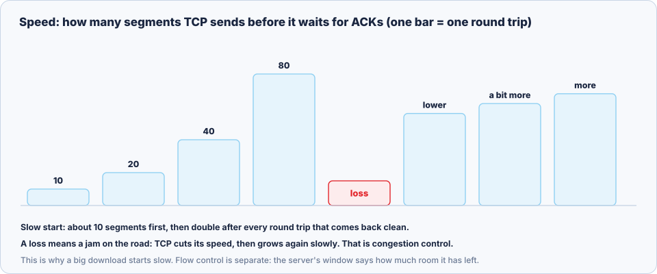

That is why a big download shows a low speed at first, and then it climbs.

**Closing.** When the work is done the connection is closed the same careful way, with segments that have the **FIN** flag on (*finish*), each side closing its own direction ([RFC 9293 §3.6](https://www.rfc-editor.org/rfc/rfc9293.html)). After that, port 51000 on the phone is free again.

> **Beyond the video: TIME-WAIT.** The side that closes first waits for a while in a state called **TIME-WAIT**, in case its last ACK was lost and the other side's FIN comes again. The RFC's value is twice the maximum segment lifetime (4 minutes); Linux uses 60 seconds. The window and the speed limit work together: a sender may have in flight no more than the smaller of the receiver's window and its own congestion window.

**The TCP header, added up.** All this bookkeeping is written in the header:

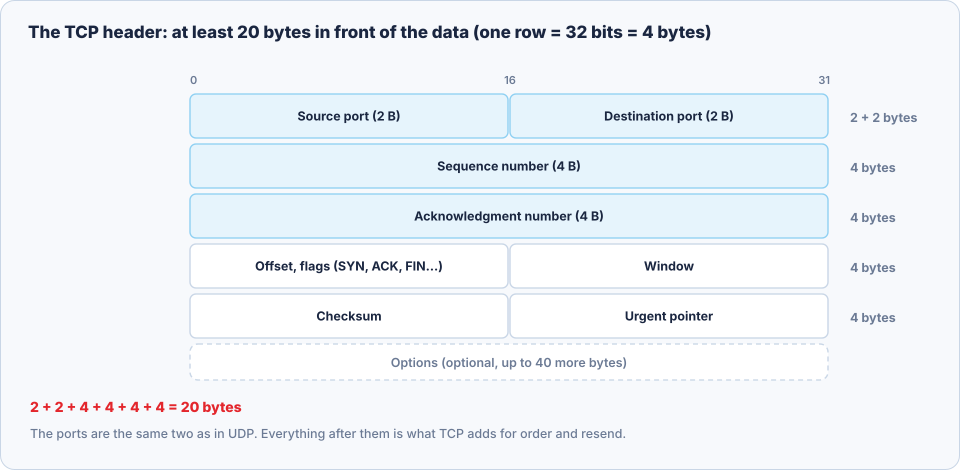

- source port 2 bytes + destination port 2 bytes;
- sequence number 4 bytes + ACK number 4 bytes;
- the rest (header length and flags, window, checksum, urgent pointer): 4 + 4 + 4 bytes.

That is 2 + 2 + 4 + 4 + 4 + 4 = **20 bytes at least** ([RFC 9293 §3.1](https://www.rfc-editor.org/rfc/rfc9293.html)), before any optional extras. The checksum is explained in the next section.

## 7. UDP: send it and move on

Think of the morning **newspaper boy**. He throws the paper over your gate and rides on: no bell, no asking whether it arrived. If a paper lands in a puddle one day, nobody brings another.

UDP is the same: **no handshake, no sequence numbers, no ACKs, no window**. A packet is made and sent. A UDP packet is called a **datagram**, and its header is only **8 bytes**: four fields of 2 bytes each ([RFC 768](https://www.rfc-editor.org/rfc/rfc768.html)).

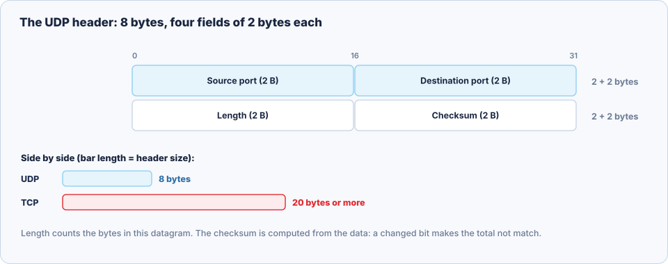

| Field | Size | Meaning |
|---|---|---|
| Source port | 2 bytes | the sender's app |
| Destination port | 2 bytes | the receiving app |
| Length | 2 bytes | how many bytes this datagram has, header included (so never below 8) |
| Checksum | 2 bytes | a small number worked out from the data, to catch damage |

**The checksum** is like the total on a bill. The receiver works it out again from what arrived, and if a bit was changed on the way, the total does not match and the datagram is **dropped**. The TCP header has a checksum too.

TCP's header is at least 20 bytes: both ports, the sequence number, the ACK number, flags, window, checksum and a few more fields. That is two and a half times UDP's 8 bytes.

That is all UDP does. What is lost stays lost, and what arrives in the wrong order is handed to the app in the wrong order. Everything else, if it is wanted, is the app's job.

> **Beyond the video: the checksum is optional on IPv4.** In IPv4 a UDP sender may set the checksum to all zeroes, meaning "not used" ([RFC 768](https://www.rfc-editor.org/rfc/rfc768.html)). In IPv6 it is required ([RFC 8200 §8.1](https://www.rfc-editor.org/rfc/rfc8200.html)). The biggest datagram is 65,535 bytes in all, so 65,507 bytes of data over IPv4 after the 20-byte IP header and the 8-byte UDP header; real apps keep to about one packet (1,472 bytes of data on a 1,500-byte link) to avoid splitting.

## 8. Why a call skips a lost packet

In an Instagram video call, your voice is cut into short slices, often **20 milliseconds** (ms) each ([RFC 7587 §6.1](https://www.rfc-editor.org/rfc/rfc7587.html): the Opus voice codec's default). One second has 1,000 milliseconds, so:

**1,000 ms ÷ 20 ms = 50 packets for every second of sound.**

Now one of those packets is lost. What should the call app do: ask for it again, skip it, or pause the call?

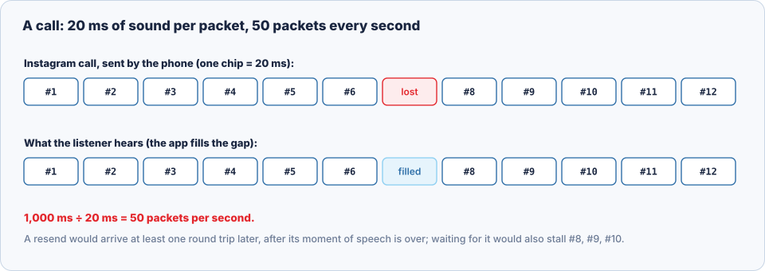

**Skip it, and play the next.** Two reasons:

1. **A resend arrives too late.** Asking again takes at least one whole round trip, and by then that 20 ms of speech should already have been played. A resent media packet may come too late to be useful ([RFC 8834 §6.1](https://www.rfc-editor.org/rfc/rfc8834.html)).
2. **Waiting stalls everything behind it** (head-of-line blocking again). The call would freeze for the resend and then rush, like a TV reporter whose answer reaches us seconds after every question.

So the app fills the 20 ms gap from the sound around it, called **packet loss concealment** ([RFC 6716 §4.4](https://www.rfc-editor.org/rfc/rfc6716.html)), and you do not even notice. A short gap you barely hear is better than a call that freezes. For a call, **on time matters more than complete.** If many packets are lost, you hear what you have heard: a robot voice, or sound that cuts in and out.

(Real call apps do use some repair tricks of their own, such as sending a little redundant data, but they do them on top of UDP, tuned for time, not through TCP's wait-for-everything rule.)

## 9. Who uses which

The rule is simple: where every byte must arrive, TCP. Where being on time matters more than being complete, UDP.

| TCP: where every byte must arrive | UDP: where on time beats complete |
|---|---|
| websites and app APIs (HTTP/1.1 and HTTP/2 use TCP: [RFC 9114 §1.1](https://www.rfc-editor.org/rfc/rfc9114.html)) | video and voice calls (WebRTC prefers UDP: [RFC 8835 §3.1](https://www.rfc-editor.org/rfc/rfc8835.html)) |
| chat messages (for example WebSocket, "layered over TCP": [RFC 6455](https://www.rfc-editor.org/rfc/rfc6455.html)) | online multiplayer games: the position is sent many times a second; a missed update is replaced by the next |
| UPI payments | DNS questions (below) |
| file downloads | QUIC, under HTTP/3 (section 10) |

If even one byte of a payment or a file is missing, the whole thing is useless. If one game position is missed, the next one is already on the way.

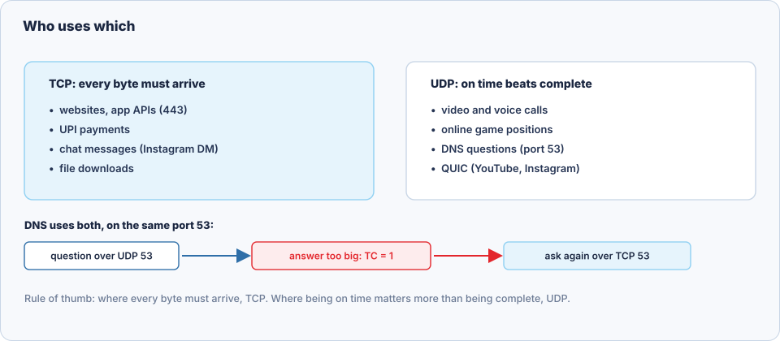

**DNS uses both.** In Ep 3 we saw the questions travel to **port 53**. Most go over UDP: one question in one packet, one answer in one packet, and if the answer does not come, the resolver simply asks again. "UDP … is the recommended method for standard queries" ([RFC 1035 §4.2.1](https://www.rfc-editor.org/rfc/rfc1035.html)). But if an answer does not fit in one UDP packet, the server sets a flag called **TC**, for *truncated* ("cut short"), and the resolver asks the same question again **over TCP, on port 53**. A DNS implementation must support both ([RFC 7766](https://www.rfc-editor.org/rfc/rfc7766.html)).

## 10. Why not UDP for everything? QUIC and HTTP/3

If UDP is so fast, why not use it for everything? Because anyone who needs order and resend would have to **build them again on top of UDP**.

And that is exactly what Google did, and named it **QUIC** (read "quick"; the RFC says it is "a name, not an acronym", [RFC 9000 §1.2](https://www.rfc-editor.org/rfc/rfc9000.html)). QUIC runs on UDP, but inside it does what TCP does: sequence numbers, ACKs, resend, and **encryption** as well ([RFC 9000](https://www.rfc-editor.org/rfc/rfc9000.html), [RFC 9002](https://www.rfc-editor.org/rfc/rfc9002.html)). Today YouTube's videos often reach your phone over QUIC, on UDP port 443, and Meta says much of the traffic of its apps, Instagram among them, goes over QUIC too ([Google, "The QUIC Transport Protocol", SIGCOMM 2017](https://dl.acm.org/doi/10.1145/3098822.3098842); [Meta Engineering, "How Facebook is bringing QUIC to billions", 2020](https://engineering.fb.com/2020/10/21/networking-traffic/how-facebook-is-bringing-quic-to-billions/)).

A big gain is **streams**: many separate ordered lines inside one connection.

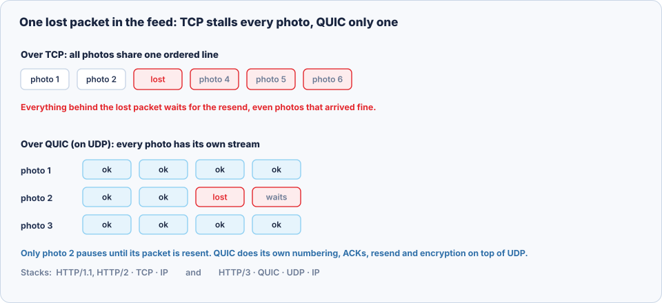

You open your Instagram feed and ten photos are coming. Over TCP, one lost segment is the toll plaza problem again: all photos wait. In QUIC every photo has its own stream, so if a packet of one photo is lost, only that photo waits: "one of the benefits of QUIC is avoidance of head-of-line blocking across multiple streams" ([RFC 9000 §13](https://www.rfc-editor.org/rfc/rfc9000.html)). The newest version of the web's protocol, **HTTP/3** (HyperText Transfer Protocol version 3), runs on QUIC ([RFC 9114](https://www.rfc-editor.org/rfc/rfc9114.html)).

Why build it on UDP and not as a new transport protocol? Because routers, firewalls and NAT boxes across the world already understand TCP and UDP, and a brand-new protocol number would be dropped by many of them. UDP gets through.

> **Beyond the video: connection set-up in QUIC.** QUIC merges the transport handshake with the security handshake (Ep 5), so a new connection needs one round trip, not TCP's one plus the security steps. A client that has talked to the server before may even send data in its first flight (**0-RTT**), with some limits on safety ([RFC 9001](https://www.rfc-editor.org/rfc/rfc9001.html)). TCP has a similar, rarely used idea: **TCP Fast Open** ([RFC 7413](https://www.rfc-editor.org/rfc/rfc7413.html)).

## 11. TCP vs UDP at a glance

| | TCP | UDP |
|---|---|---|
| Connection | handshake first (SYN, SYN ACK, ACK) | none |
| Unit | segment | datagram |
| Numbers | every byte numbered (SEQ), every segment answered (ACK) | none |
| Delivery | all bytes, in order; lost parts resent | best effort; lost stays lost |
| Waiting | head-of-line blocking | never waits |
| Flow and congestion control | yes (window, slow start) | no (the app or QUIC adds its own) |
| Header | 20 bytes at least | 8 bytes |
| Typical use | websites, app APIs, chat, UPI payments, downloads | calls, games, DNS questions, QUIC |

## 12. Interview questions

Each question says where it comes from:

- **Reported**: a candidate wrote publicly that they were asked it. It does not mean the company still asks it.
- **Tagged**: a question bank lists the problem with that company's tag. It does not say that anyone was asked it.
- **Common topic**: it appears on many interview preparation lists.
- **Our question**: written by us to test the idea.

The two questions inside the video, about the ACK after a lost segment and about the lost voice packet, are answered in sections 5 and 8. The first four below are the video's interview round. Try each one before you read the answer.

### From the video

**1. What is the difference between TCP and UDP? Give three differences.**

*Reported · Swiggy · SDE 2 (Software Development Engineer 2), Bangalore · LeetCode Discuss, Feb 2022.* The candidate listed it in round 3. [The post](https://leetcode.com/discuss/interview-experience/1752565)

1. **Connection.** TCP does a handshake first; UDP sends straight away.
2. **Delivery.** TCP delivers every byte, in order, and resends what is lost; UDP does neither.
3. **Header.** UDP's is 8 bytes; TCP's is at least 20.

A good answer adds one line on **when to use which** (sections 8 and 9): TCP for web, UPI and chat; UDP for calls and games, where late data is useless.

**2. Do different browser tabs use different port numbers?**

*Reported · Amazon · AWS Cloud Support Associate, campus, 2020 · GeeksforGeeks (updated Oct 2024).* The candidate was asked it in the third round, next to "What are ports and port numbers?" and a detailed TCP handshake. [The post](https://www.geeksforgeeks.org/interview-experiences/amazon-aws-interview-experience-for-cloud-support-associate-2020/)

Count **connections**, not tabs. The server side stays the same: port 443. On the phone's side, **every new connection gets its own free port**, for example 51000, 51001, 51002 (section 2):

```text
:51000 -> :443
:51001 -> :443
:51002 -> :443
```

Two tabs to the same site may share one connection (HTTP/2 does that) or open several, so the number of source ports is the number of connections. The four numbers differ in the source port, so the server and the NAT can tell the conversations apart.

**3. Design an Ordered Stream. (LeetCode 1656.)**

*Tagged · Bloomberg, Meta · LeetCode 1656.* The company tags come from a public mirror of LeetCode's premium data ([the problem](https://leetcode.com/problems/design-an-ordered-stream/), [the mirror](https://github.com/liquidslr/leetcode-company-wise-problems), commit 2b71796). It is a tag, not a report that anyone was asked it.

It is what a TCP receiver does. Packets numbered 1 to 5 arrive as 3, then 1, then 2; after every arrival, give back every packet that is now ready **in order**. After 3: nothing (1 is missing). After 1: `[1]`. After 2: `[2, 3]`, because 3 was waiting on the side. You need an array and a **pointer** to the next number wanted:

```python
class OrderedStream:
    def __init__(self, n):
        self.slots = [None] * (n + 2)      # slots 1..n; index 0 unused
        self.ptr = 1                       # the next number we are waiting for

    def insert(self, id_key, value):
        self.slots[id_key] = value
        out = []
        while self.ptr < len(self.slots) - 1 and self.slots[self.ptr] is not None:
            out.append(self.slots[self.ptr])
            self.ptr += 1                  # the pointer jumps over everything that is ready
        return out

s = OrderedStream(5)
print(s.insert(3, "ccccc"))   # []
print(s.insert(1, "aaaaa"))   # ['aaaaa']
print(s.insert(2, "bbbbb"))   # ['bbbbb', 'ccccc']
```

Each value is stored once and the pointer only moves forward, so the total work is O(n) for n inserts.

**4. An online game sends every player's position 20 times a second, and also has a chat. What would you use TCP for, and what UDP?**

*Our question · system design.*

**Positions: UDP.** An old position is useless, because the next one is already coming. **Chat: TCP.** Every message must arrive, whole and in order. One game can use both at once, on different ports or connections. (Many real games put reliable events, such as "player joined", on a reliable channel built over UDP; that is a design choice on top of this idea, not a different rule.)

### More practice

**5. Why does TCP need three steps in its handshake, not two?** *Common topic.* Each side must send its starting number and have it confirmed (four jobs); the server's SYN and ACK go in one segment (three steps). The deeper reason: with two steps a delayed old SYN could open a connection nobody wants (section 3, Beyond the video).

**6. A server has received segments 1, 3 and 4. What ACK does it send, and why?** *Our question.* ACK for the first missing byte: the cumulative ACK stays at the end of segment 1's data. With our 10-byte segments from byte 1001, segment 1 ends at 1010, so the ACK is **1011**. It does not mention segments 3 and 4. They are kept, and when segment 2 arrives the ACK jumps to the end of segment 4 (1041).

**7. Why does a video call use UDP while a file download uses TCP?** *Common topic.* In a call a resent packet arrives too late and the wait stalls the sound, so on time beats complete. In a download, a missing byte ruins the file, so complete beats on time.

**8. What is head-of-line blocking, and how does HTTP/3 reduce it?** *Common topic.* One lost segment holds back everything behind it, because TCP gives bytes to the app in order. HTTP/3 runs each photo or file in its own QUIC stream, so a loss stalls only its own stream (section 10).

**9. Which transport does DNS use?** *Common topic.* Both, on port 53: UDP for normal questions; TCP when the answer is cut (TC flag) and for some other cases (section 9).

**10. What identifies a TCP connection?** *Common topic.* The four numbers: source IP, source port, destination IP, destination port. That is why a server on port 443 can hold millions of connections: each client brings a different address or source port.

**11. Is UDP always faster than TCP?** *Our question.* It has less to do (no handshake, no waiting), so it starts sooner and never stalls, but it does not make the packets travel faster. A UDP app that needs reliability and builds it itself, like QUIC, pays a similar price.

**12. Other reported questions** (each one a TCP/UDP difference or a handshake explanation, for practice): *MakeMyTrip, SDE-1, Gurugram, on-campus, Aug 2022* ([post](https://leetcode.com/discuss/interview-experience/2453362)); *Juspay, Product Engineer Intern, Mumbai, Aug 2021: "UDP vs TCP, HTTP vs HTTPs"* ([post](https://leetcode.com/discuss/interview-experience/2641415)); *Cisco, Software Engineer, Bangalore, Dec 2021: "TCP/UDP, tracert, ping"* ([post](https://leetcode.com/discuss/interview-experience/1645339)). Across the 8 candidate posts we opened, "difference between TCP and UDP" came up in 7.

## 13. Try it yourself

1. **Watch a TCP connection and a UDP "connection" with `nc` (netcat).** Open two terminals.

```bash
# terminal 1: wait for a TCP connection on port 9000
nc -l 9000
# terminal 2: connect (the handshake happens now), then type a line
nc 127.0.0.1 9000
```

   What you type in terminal 2 appears in terminal 1. (Some Linux versions of `nc` want `nc -l -p 9000`.) Now UDP, where nothing connects:

```bash
# terminal 1: listen for UDP datagrams on port 9001
nc -u -l 9001
# terminal 2: send one datagram, with no handshake
echo hello | nc -u -w1 127.0.0.1 9001
```

   Stop terminal 1 and send again: the sender notices nothing, because UDP never asked.

2. **See your own connections and their four numbers.**

```bash
ss -tan            # Linux: TCP, numeric; look at State ESTAB and the two address:port columns
netstat -an -p tcp # Mac; on Windows: netstat -an
```

   Each `ESTAB` line is one connection: local address and port (your phone-side number, usually a high one), then the remote address and port (often 443). Open one more tab on the same site and compare the lines.

3. **See ports in a handshake from Python.** A tiny server and client on your own machine:

```python
import socket, threading

srv = socket.socket(socket.AF_INET, socket.SOCK_STREAM)
srv.setsockopt(socket.SOL_SOCKET, socket.SO_REUSEADDR, 1)
srv.bind(("127.0.0.1", 9000)); srv.listen()        # the server's fixed port

def serve():
    conn, addr = srv.accept()                       # returns after the handshake
    print("server sees the client at", addr)
    print(conn.recv(100)); conn.close()

t = threading.Thread(target=serve); t.start()
c = socket.create_connection(("127.0.0.1", 9000))
print("client:", c.getsockname(), "->", c.getpeername())   # the four numbers
c.sendall(b"hello over tcp"); t.join(); c.close()
```

   The client's port is a number you did not choose: the system picked an ephemeral port. Run it again: it changes.

4. **The same message over UDP.**

```python
import socket
u = socket.socket(socket.AF_INET, socket.SOCK_DGRAM); u.bind(("127.0.0.1", 9001))
v = socket.socket(socket.AF_INET, socket.SOCK_DGRAM)
v.sendto(b"hello over udp", ("127.0.0.1", 9001))   # no connect, no handshake
print(u.recvfrom(100))
```

   There is no `listen`, no `accept` and no `connect`. If nobody had been bound to port 9001, `sendto` would still have succeeded.

5. **DNS over UDP, then over TCP.**

```bash
dig instagram.com        # sent over UDP port 53 (the SERVER line shows the resolver)
dig +tcp instagram.com    # the same question over TCP port 53
```

   Both give the same answer. (The `+tcp` run is what a resolver does after a truncated answer.)

6. **Time the handshake.** `curl` can show how long the TCP connection took, before anything else:

```bash
curl -s -o /dev/null -w "tcp connect: %{time_connect}s\n" https://www.instagram.com
```

   Run it against a nearby and a far-away site: the connect time is close to one round trip.

7. **See the handshake and its numbers.** `tcpdump` prints every packet; it needs admin rights (`sudo`). In one terminal:

```bash
sudo tcpdump -n -i any 'tcp port 443 and host www.instagram.com'
```

   In another, run `curl -s -o /dev/null https://www.instagram.com`. The first three lines are the handshake: flags `[S]` (SYN), `[S.]` (SYN ACK) and `[.]` (ACK), with `seq` and `ack` numbers. They are huge, because real starting numbers are random; `tcpdump` also shows them relative to the start (`seq 0`, `ack 1`) unless you add `-S`. Notice the port on your side: that is the free port the system picked.

## 14. One-page revision

- IP can lose, duplicate and reorder packets. **TCP** (Transmission Control Protocol) and **UDP** (User Datagram Protocol) decide what to do about it. Protocol = rules both sides follow. Instagram DM: TCP. Instagram call: UDP.
- **Port** = 16 bits, 0 to 65,535, so 65,536 ports for TCP and 65,536 for UDP. IP address = station, port = platform. **Servers: fixed ports** from IANA's list: 80 HTTP, 443 HTTPS (websites, app APIs, Instagram), 53 DNS, 22 SSH, 25 SMTP, 5432 PostgreSQL, 3306 MySQL. WebSocket and SSL/TLS ride on 80 / 443. 0 to 1,023 = well-known ports. **Phone:** a free port per connection (Android 32,768 to 60,999; e.g. 51000), freed when the connection closes. **Four numbers** = one connection: `192.168.1.5:51000` and `57.144.x.x:443`.
- **TCP handshake:** `SYN SEQ 1000` (no data) → `SYN ACK SEQ 5000 ACK 1001` → `ACK SEQ 1001 ACK 5001`. **ACK number = the next byte I need.** Four jobs, three segments (the server merges SYN and ACK). Cost: one round trip before data, so apps keep one long-lived connection. Real starting numbers are random.
- **Segment** = header + data. **Flag** = one bit (SYN, ACK, FIN). **Sequence number counts bytes**, and a segment's SEQ is its first byte. 1 English character = 1 byte = 8 bits. Real segment about 1,400 bytes. Demo: "Kal 5 baje CP pe milte hain :)" = 30 bytes = 3 segments: SEQ 1001, 1011, 1021; ACKs 1011, 1021, 1031. "milte" gets cut: TCP counts bytes, not words.
- **Lost segment 2:** the server keeps sending ACK 1011 (duplicate ACKs), keeps segment 3 on the side. The phone resends on the **timer** (RTO) or after **3 duplicate ACKs** (fast retransmit). Then ACK 1031. **Head-of-line blocking:** everything behind the lost segment waits (toll plaza).
- **Speed:** **window** (receiver's free room) = flow control. **Congestion control:** about 10 segments first, doubling (10, 20, 40, 80), cut on loss. Downloads start slow. **FIN** closes the connection and frees the port.
- **UDP:** no handshake, no numbers, no ACK, no window, no resend. **Datagram.** **Header 8 bytes** (2 each): source port, destination port, length, checksum. **TCP header at least 20 bytes.** Bad checksum = dropped.
- **Call:** 20 ms per packet, 50 packets a second. A resend arrives too late and waiting stalls the rest, so skip the lost packet and conceal the gap. On time beats complete.
- **TCP:** websites, app APIs, chat, UPI payments, downloads. **UDP:** calls, games. **DNS:** UDP 53, TCP 53 after a truncated (TC) answer.
- **QUIC** (Google) = order, ACK, resend and encryption rebuilt on UDP, one stream per photo. YouTube and much of Instagram's traffic use it. **HTTP/3** runs on it: a loss stalls one photo, not the feed.
- Commands: `nc -l 9000` and `nc 127.0.0.1 9000`; `nc -u`; `ss -tan` or `netstat -an`; `dig +tcp instagram.com`; `sudo tcpdump -n 'tcp port 443'`.
- Next: Ep 5. The bytes now arrive whole and in order; what do the app and the server say inside them, and what is the lock in the browser?

## Sources

- TCP: [RFC 9293](https://www.rfc-editor.org/rfc/rfc9293.html) (Aug 2022: sections 2.2, 3.1, 3.2, 3.4, 3.5, 3.6, 3.7.1, 3.8.6, 3.10.7.4) · initial sequence numbers: [RFC 6528](https://www.rfc-editor.org/rfc/rfc6528.html) · loss, slow start and fast retransmit: [RFC 5681](https://www.rfc-editor.org/rfc/rfc5681.html) · selective ACK: [RFC 2018](https://www.rfc-editor.org/rfc/rfc2018.html) · initial window of 10: [RFC 6928](https://www.rfc-editor.org/rfc/rfc6928.html) · CUBIC: [RFC 9438](https://www.rfc-editor.org/rfc/rfc9438.html) · retransmission timer: [RFC 6298](https://www.rfc-editor.org/rfc/rfc6298.html) · window scaling: [RFC 7323](https://www.rfc-editor.org/rfc/rfc7323.html) · SYN floods: [RFC 4987](https://www.rfc-editor.org/rfc/rfc4987.html) · Fast Open: [RFC 7413](https://www.rfc-editor.org/rfc/rfc7413.html)
- UDP: [RFC 768](https://www.rfc-editor.org/rfc/rfc768.html) · IPv6 checksum rule: [RFC 8200](https://www.rfc-editor.org/rfc/rfc8200.html) · packets and IP: [RFC 791](https://www.rfc-editor.org/rfc/rfc791.html) · one byte per English character: UTF-8, [RFC 3629](https://www.rfc-editor.org/rfc/rfc3629.html)
- Ports: [RFC 6335](https://www.rfc-editor.org/rfc/rfc6335.html) · ephemeral ports: [RFC 6056](https://www.rfc-editor.org/rfc/rfc6056.html) · [IANA Service Name and Transport Protocol Port Number Registry](https://www.iana.org/assignments/service-names-port-numbers/) · Linux default local port range (`ip_local_port_range`): [kernel ip-sysctl documentation](https://www.kernel.org/doc/html/latest/networking/ip-sysctl.html) · HTTP and HTTPS ports: [RFC 9110 §4.2](https://www.rfc-editor.org/rfc/rfc9110.html) · HTTP over TLS: [RFC 2818](https://www.rfc-editor.org/rfc/rfc2818.html) · TLS 1.3: [RFC 8446](https://www.rfc-editor.org/rfc/rfc8446.html) · keep-alive: [RFC 9112 §9](https://www.rfc-editor.org/rfc/rfc9112.html)
- Calls: [RFC 7587](https://www.rfc-editor.org/rfc/rfc7587.html) (Opus over RTP, 20 ms) · [RFC 6716 §4.4](https://www.rfc-editor.org/rfc/rfc6716.html) (loss concealment) · [RFC 8834 §6.1](https://www.rfc-editor.org/rfc/rfc8834.html) · [RFC 8835 §3.1](https://www.rfc-editor.org/rfc/rfc8835.html) · WebSocket: [RFC 6455](https://www.rfc-editor.org/rfc/rfc6455.html) · games on UDP: [Riot Games, Leveling Up Networking for a Multi-game Future, 29 June 2021](https://www.riotgames.com/en/news/leveling-networking-multi-game-future)
- DNS transport: [RFC 1035 §4.1.1 and §4.2](https://www.rfc-editor.org/rfc/rfc1035.html) · [RFC 7766](https://www.rfc-editor.org/rfc/rfc7766.html)
- QUIC and HTTP/3: [RFC 9000](https://www.rfc-editor.org/rfc/rfc9000.html) · [RFC 9001](https://www.rfc-editor.org/rfc/rfc9001.html) · [RFC 9002](https://www.rfc-editor.org/rfc/rfc9002.html) · [RFC 9114](https://www.rfc-editor.org/rfc/rfc9114.html) · Google, [The QUIC Transport Protocol (SIGCOMM 2017)](https://dl.acm.org/doi/10.1145/3098822.3098842) · Meta Engineering, [How Facebook is bringing QUIC to billions (Oct 2020)](https://engineering.fb.com/2020/10/21/networking-traffic/how-facebook-is-bringing-quic-to-billions/)
- Interview write-ups: [Swiggy SDE 2, LeetCode Discuss](https://leetcode.com/discuss/interview-experience/1752565) · [Amazon AWS Cloud Support Associate, GeeksforGeeks](https://www.geeksforgeeks.org/interview-experiences/amazon-aws-interview-experience-for-cloud-support-associate-2020/) · [LeetCode 1656](https://leetcode.com/problems/design-an-ordered-stream/) · [company tag mirror](https://github.com/liquidslr/leetcode-company-wise-problems) (commit 2b71796)
- The numbers in the examples (1000, 5000, 51000, the 10-byte segments) are made easy on purpose; the facts come from the RFCs and pages above, checked against the script's fact-check table on 15 November 2026. The diagrams are drawn by `tools/diagrams_ep04.py`.
